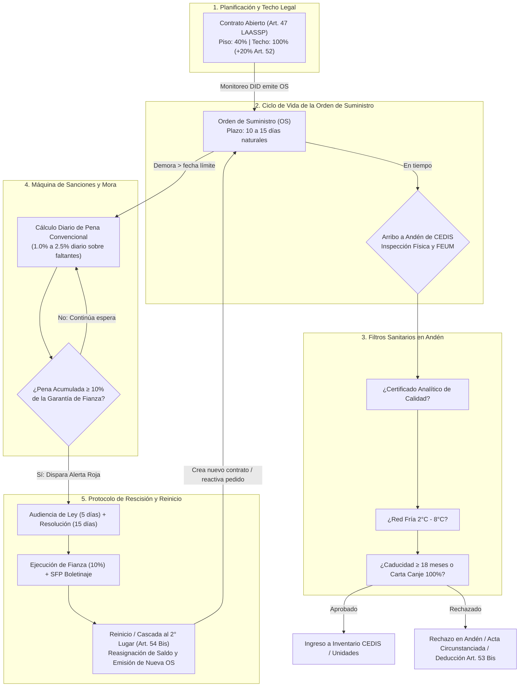
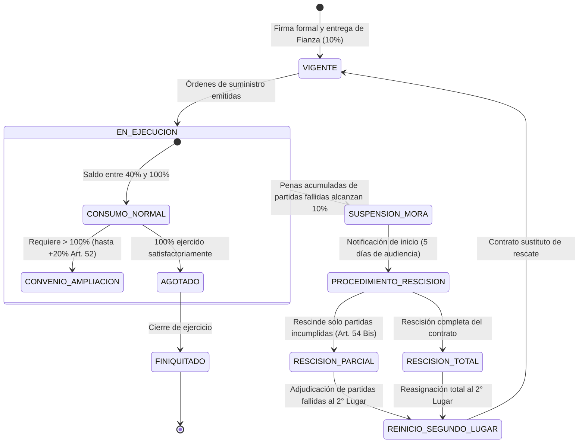
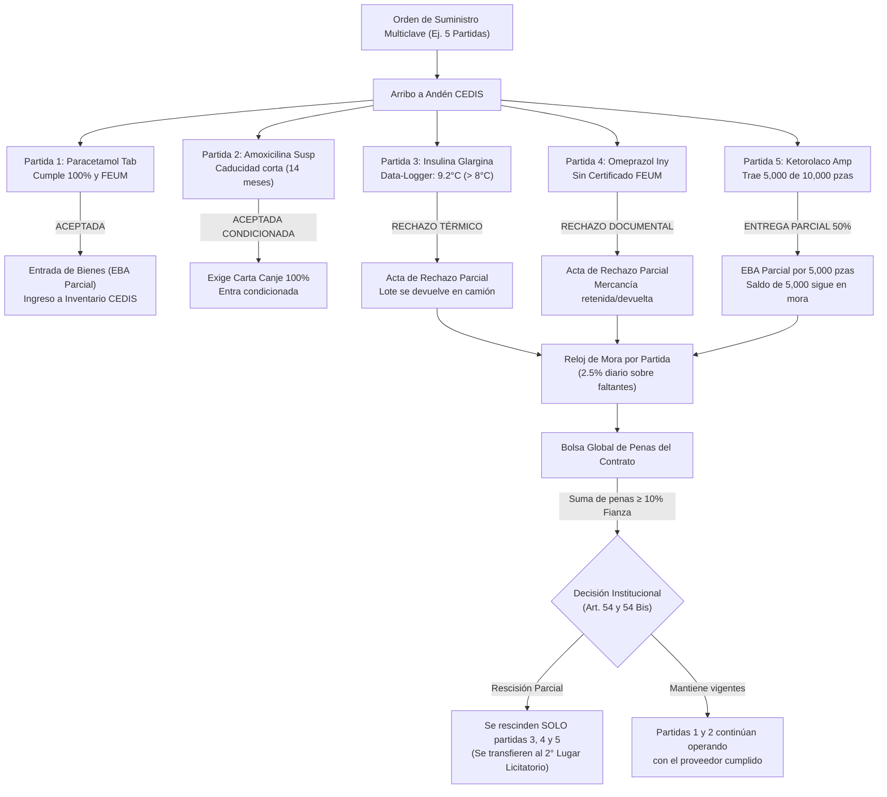
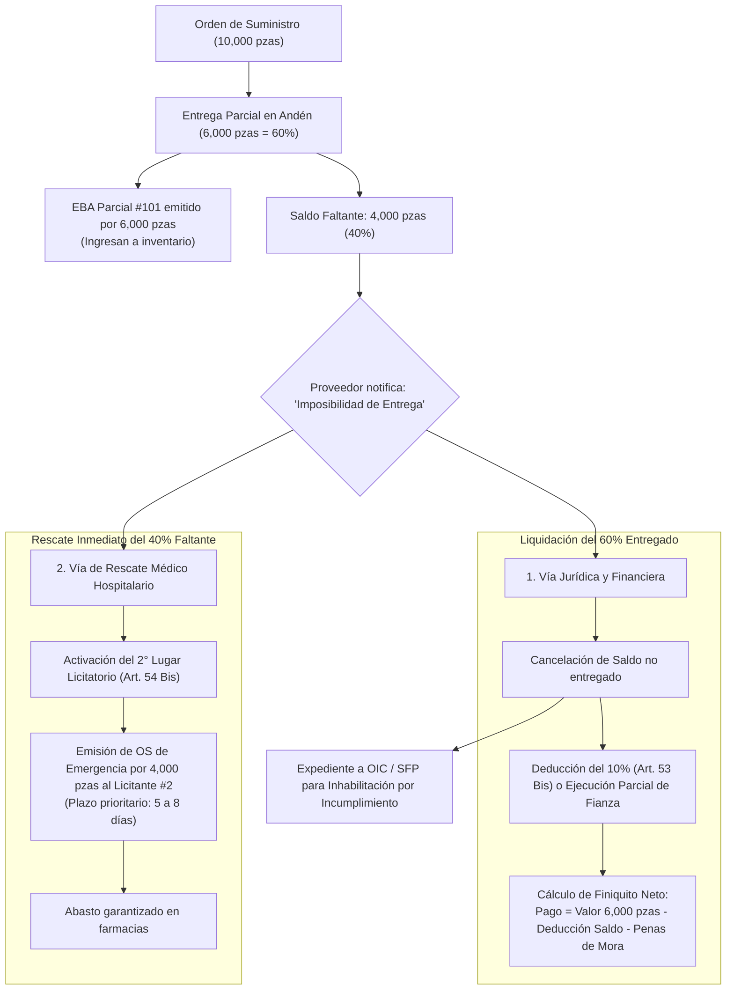

# Especificación y Modelo de Simulación: Contratos, Órdenes de Suministro y Penalizaciones

> [!IMPORTANT]
> **Documento Vinculado de Procesos y Alertas:**
> Este modelo computacional de contratos y órdenes se rige por el ciclo integral de **12 procesos**, el inventario de **30 documentos oficiales** y la **matriz de semáforos y SLAs de alerta temprana** detallados exhaustivamente en [**`PROCESOS_Y_ALERTAS.md`**](PROCESOS_Y_ALERTAS.md).

Este documento traduce el marco jurídico, administrativo y operativo de las adquisiciones consolidadas en el sector salud de México (LAASSP, IMSS, ISSSTE, Birmex) a un **modelo computacional de objetos, eventos discretos y máquinas de estado finitas (FSM)**.

Permite simular el ciclo de vida contractual completo, la respuesta de los proveedores, el cálculo diario de penalizaciones por mora, el control de andén, las alertas preventivas y el **mecanismo de rescisión y reinicio automático de suministro con el segundo lugar licitatorio**.

---

## 1. La Visión del Modelo: La Cadena como un Grafo de Nodos y Estados

En la simulación, un contrato no es un documento pasivo: es una **entidad viva (nodo activo)** que gestiona presupuestos, vigila plazos, acumula sanciones y, en caso de fallo catastrófico, se apaga y transfiere su estado a un **nodo sustituto** para garantizar que los hospitales no caigan en desabasto.

Este modelo opera como el motor lógico que procesa los **Documentos 1 al 14 y 26 al 28** del inventario documental oficial (ver [PROCESOS_Y_ALERTAS.md](PROCESOS_Y_ALERTAS.md)):
*   **Documento 3:** Contrato Abierto de Suministro (Art. 47 LAASSP).
*   **Documento 4:** Póliza de Fianza de Cumplimiento (10%).
*   **Documentos 6 y 7:** Orden de Suministro (OS) y Acuse Electrónico de Notificación.
*   **Documentos 9 a 14:** Remisión, Certificado FEUM, Data-Logger de Red Fría, Carta Canje, EBA y Acta de Rechazo.
*   **Documentos 26 a 28:** Factura CFDI, Cédula de Penas (Art. 53) y Nota de Crédito.



---

## 2. Máquina de Estados Finitos (FSM) de los Objetos

### A. FSM de la `OrdenSuministro` (Lifecycle State Machine)

Cada orden de suministro transita por estados bien definidos impulsados por eventos de tiempo y acciones de andén:

```mermaid
stateDiagram-v2
    [*] --> BORRADOR: Sistema detecta stock bajo reorden
    BORRADOR --> EMITIDA: Aprobación de Subdirección de Abasto
    EMITIDA --> NOTIFICADA: Acuse de recibo electrónico (Inicia t_plazo)
    
    NOTIFICADA --> EN_TRANSITO: Proveedor reporta despacho
    NOTIFICADA --> ATRASADA: t > t_limite (Se activa cálculo diario de pena)
    
    EN_TRANSITO --> EN_ANDEN: Camión arriba al CEDIS
    EN_TRANSITO --> ATRASADA: t > t_limite sin arribar
    
    ATRASADA --> EN_ANDEN: Arribo tardío (se liquida pena)
    ATRASADA --> RESCISION_DISPARADA: Pena acumulada alcanza 10% del contrato
    
    EN_ANDEN --> INSPECCION_CALIDAD: Descarga y lectura de data-logger
    
    INSPECCION_CALIDAD --> RECIBIDA_COMPLETA: Dictamen ACEPTADO (100% piezas)
    INSPECCION_CALIDAD --> RECIBIDA_PARCIAL: Aceptación parcial (faltantes o rechazos)
    INSPECCION_CALIDAD --> RECHAZADA_TOTAL: Quiebre de red fría / sin certificado FEUM
    
    RECIBIDA_PARCIAL --> ATRASADA: Saldo pendiente sigue corriendo mora
    RECHAZADA_TOTAL --> ATRASADA: Mercancía devuelta; proveedor en mora
    
    RECIBIDA_COMPLETA --> CERRADA_PAGADA: Liquidación con descuento de pena
    RESCISION_DISPARADA --> CANCELADA_POR_RESCISION: Finiquito legal
    CANCELADA_POR_RESCISION --> [*]
    CERRADA_PAGADA --> [*]
```



### B. FSM del `Contrato` y el Nodo de Rescisión/Reinicio



---

### C. La Realidad Operativa: Contratos Multipartida y Recepciones Mixtas

En el sector salud público mexicano (IMSS, ISSSTE, Birmex), los contratos casi nunca son de una sola clave médica. Se adjudican **contratos multipartida con 10, 20 o hasta 50 claves CNIS distintas** a un mismo proveedor.

Cuando se emite una Orden de Suministro por varias partidas simultáneas y arriba el camión a andén, se produce una **Recepción Mixta**:



#### Reglas de Negocio Legales para Recepciones Mixtas:

1. **La Pena Convencional es Quirúrgica (Partida por Partida):**
   Conforme a los Artículos 95 y 96 del Reglamento de la LAASSP, la pena convencional **NUNCA se aplica sobre el valor total de la orden ni del contrato**. Se aplica **estricta y exclusivamente sobre el valor de los bienes no entregados o rechazados de esa partida específica**:
   $$\text{Pena Diaria}_{\text{Partida } i} = (\text{Piezas Solicitadas}_i - \text{Piezas Aceptadas en EBA}_i) \times \text{Precio Unitario}_i \times \text{Tasa Diaria (2.5\%)}$$
   Las partidas entregadas y aceptadas a satisfacción (como el Paracetamol en el ejemplo) quedan legalmente **libres de toda penalización**.

2. **La Bolsa Global de Penas y el Tope de Fianza del 10%:**
   Aunque la pena se calcula partida por partida, las penalizaciones de todas las partidas se acumulan en una **cuenta corriente global del contrato**.
   $$\text{Pena Acumulada Contrato} = \sum_{i=1}^{n} \text{Penas}_{\text{Partida } i}$$
   La póliza de fianza garantiza el 10% del monto total del contrato. Si la suma de penas de las partidas problemáticas alcanza el tope del 10% de la fianza global, se activa la causal de rescisión.

3. **Facultad de Rescisión Parcial (Art. 54 Bis, segundo párrafo LAASSP):**
   La ley mexicana otorga a las instituciones de salud la facultad de **no cancelar todo el contrato si el proveedor entrega bien unas claves y mal otras**. La dependencia puede dictar:
   * **Rescisión Parcial:** Cancela únicamente las partidas incumplidas (ej. la Insulina y el Ketorolaco), las cobra contra la fianza proporcional y **las adjudica al Licitante Segundo Lugar**.
   * **Continuidad de Partidas Cumplidas:** Mantiene vigente el contrato con el proveedor original para las partidas donde el abasto fluye puntualmente, evitando desestabilizar claves que no tienen problemas.

4. **Regla de Facturación Estricta (CFDI vs EBA Parcial):**
   El proveedor **no puede emitir una factura electrónica por el 100% de la Orden de Suministro** si hubo rechazos parciales. La factura (CFDI) debe coincidir al centavo únicamente con las piezas efectivamente amparadas en la EBA Parcial. Cualquier factura que incluya mercancía devuelta o no entregada es rechazada automáticamente por el validador contable.

---

### D. Incapacidad Manifiesta de Entrega de Saldo (La "Entrega Trunca")

Un escenario sumamente frecuente en la realidad médica es cuando el proveedor entrega una fracción de la orden (por ejemplo, el 60%) y posteriormente **notifica formalmente (o incurre en imposibilidad física) que ya no podrá surtir el 40% restante** (por quiebre de materia prima activa / API, clausura de línea por COFEPRIS o pérdida de capacidad financiera).



#### Reglas de Operación para la Entrega Trunca:

1. **Finiquito Asimétrico (Pagar lo recibido sin soltar la garantía):**
   * El proveedor tiene derecho a cobrar las 6,000 piezas que sí entregó y fueron aceptadas a entera satisfacción.
   * Sin embargo, Finanzas **no liquida la factura en su totalidad**. Aplica la deducción del Art. 53 Bis sobre el valor de las 4,000 piezas que dejó colgadas, más las penas convencionales devengadas hasta la fecha de la notificación de incapacidad.
   $$\text{Monto Neto a Pagar} = \text{Importe de Piezas Recibidas} - \text{Penas Devengadas} - \text{Deducción por Saldo Incumplido}$$

2. **Reasignación Exprés del Saldo al 2° Lugar (Art. 54 Bis):**
   * El sistema informático extrae de inmediato el saldo remanente (4,000 piezas).
   * La ley permite no abrir una licitación nueva (que demoraría 45 días y dejaría a los enfermos sin medicina). Invita formalmente al **Licitante que obtuvo el Segundo Lugar** en la licitación original para que acepte suministrar las 4,000 piezas faltantes al precio cotizado originalmente.
   * En cuanto el Licitante #2 acepta, se le expide una **Orden de Suministro de Rescate con plazo perentorio de 5 a 8 días**, cerrando la brecha antes de que las unidades agoten su reserva.

3. **Boletinaje y Sanción Administrativa:**
   * La manifestación de no poder entregar no exime de responsabilidad legal. El Administrador del Contrato turna el acta al Órgano Interno de Control (OIC) y a la SFP para que se inicie el procedimiento sancionador (multa económica e inhabilitación temporal en Compranet).

---

## 3. Definición de Objetos para Simulación (Estructuras de Datos)

A continuación se define la estructura de clases en pseudocódigo orientado a objetos (compatible con JavaScript/TypeScript y Python) para integrarse en el motor del gemelo digital:

### Objeto 1: `ContratoAbierto`
Representa el marco legal y financiero entre la institución y un proveedor adjudicado.

```javascript
class ContratoAbierto {
  constructor(config) {
    this.id = config.id;                         // "CS-2026-IMSS-045"
    this.institucion = config.institucion;       // "IMSS" | "ISSSTE" | "IMSS_BIENESTAR"
    this.proveedorId = config.proveedorId;       // Referencia al objeto Proveedor
    this.proveedorNombre = config.proveedorNombre;
    
    // Parámetros Financieros (Art. 47 LAASSP)
    this.montoMinimo = config.montoMinimo;       // 40% del total planeado ($)
    this.montoMaximo = config.montoMaximo;       // 100% del total planeado ($)
    this.montoEjecutado = 0.0;                   // Suma de OS facturadas ($)
    this.montoComprometido = 0.0;                // Suma de OS emitidas en tránsito ($)
    
    // Garantía y Sanciones (Art. 53 y 54 LAASSP)
    this.porcentajeFianza = 0.10;                // 10% del monto máximo sin IVA
    this.topeGarantia = this.montoMaximo * this.porcentajeFianza;
    this.penasAcumuladas = 0.0;                  // Total de penas descontadas/retenidas
    this.tasaPenaDiaria = config.tasaPenaDiaria || 0.025; // 2.5% diario (0.025)
    
    // Catálogo de Claves Adjudicadas en este Contrato
    this.claves = new Map(); // claveCNIS -> { precioUnitario, cantMin, cantMax, cantEjecutada }
    
    // Estados: 'ACTIVO', 'AMPLIADO_CONVENIO', 'EN_RIESGO', 'EN_RESCISION', 'RESCINDIDO', 'FINIQUITADO'
    this.estado = 'ACTIVO';
    this.licitanteSegundoLugar = config.segundoLugar || null; // Fallback para Art. 54 Bis
  }

  // Valida si una nueva solicitud de OS no desborda el techo presupuestal
  validarTecho(claveCNIS, cantidad) {
    const item = this.claves.get(claveCNIS);
    if (!item) return { valido: false, motivo: "Clave no adjudicada en este contrato" };
    
    const saldoDisponible = (item.cantMax * 1.20) - item.cantEjecutada; // Permite 20% convenio
    if (cantidad > saldoDisponible) {
      return { 
        valido: false, 
        motivo: `Excede techo legal. Disponible: ${saldoDisponible}, Solicitado: ${cantidad}` 
      };
    }
    return { valido: true };
  }
}
```

---

### Objeto 2: `OrdenSuministro` (OS)
Representa la orden de compra operativa emitida al proveedor.

```javascript
class OrdenSuministro {
  constructor(config) {
    this.id = config.id;                         // "OS-2026-CEDIS-0142"
    this.contratoId = config.contratoId;
    this.almacenDestino = config.almacenDestino; // "CEDIS_PACHUCA" | "REGIONAL_TULA"
    this.claveCNIS = config.claveCNIS;
    this.descripcion = config.descripcion;
    
    // Volúmenes y Precios
    this.cantidadSolicitada = config.cantidadSolicitada;
    this.cantidadRecibida = 0;
    this.precioUnitario = config.precioUnitario;
    this.importeTotal = this.cantidadSolicitada * this.precioUnitario;
    
    // Cronometría Legal
    this.fechaEmision = config.tActual;
    this.fechaNotificacion = null;
    this.diasPlazo = config.diasPlazo || 15;      // 10 a 15 días naturales estándar
    this.fechaLimite = null;                     // fechaNotificacion + diasPlazo
    
    // Variables de Mora y Semáforos (SLA según PROCESOS_Y_ALERTAS.md)
    this.diasAtraso = 0;
    this.montoPenaCalculado = 0.0;
    this.dictamenCalidad = null;
    this.semaforo = 'VERDE';                     // 'VERDE' | 'AMARILLO' | 'NARANJA' | 'ROJO'
    
    // Estados: 'EMITIDA', 'NOTIFICADA', 'EN_TRANSITO', 'RECIBIDA_PARCIAL', 'RECIBIDA_COMPLETA', 'ATRASADA', 'RESCINDIDA'
    this.estado = 'EMITIDA';
  }

  notificar(tActual) {
    this.fechaNotificacion = tActual;
    this.fechaLimite = tActual + (this.diasPlazo * 86400); // 86400 seg/día
    this.estado = 'NOTIFICADA';
  }

  // Evaluación en cada tick de la simulación conforme a la Matriz de Semáforos
  actualizarTick(tActual, tasaDiaria) {
    if (this.estado === 'RECIBIDA_COMPLETA' || this.estado === 'RESCINDIDA') return;
    
    if (!this.fechaLimite) return;

    const segundosTranscurridos = tActual - this.fechaNotificacion;
    const diasTranscurridos = Math.floor(segundosTranscurridos / 86400);

    // Evaluación de Semáforo según SLA de Entrega (15 días naturales)
    if (tActual <= this.fechaLimite) {
      if (diasTranscurridos <= 9) {
        this.semaforo = 'VERDE';      // Días 1-9: Progreso normal
      } else if (diasTranscurridos <= 13) {
        this.semaforo = 'AMARILLO';   // Días 10-13: Alerta preventiva si no hay aviso de rampa
      } else {
        this.semaforo = 'NARANJA';    // Días 14-15: Alerta crítica, riesgo inminente de mora
      }
    } else {
      // Día 16+: Vencimiento y Mora Activa
      this.estado = 'ATRASADA';
      this.semaforo = 'ROJO';         // Alerta Roja: Sanción activa
      
      const segundosAtraso = tActual - this.fechaLimite;
      this.diasAtraso = Math.ceil(segundosAtraso / 86400);
      
      const piezasPendientes = this.cantidadSolicitada - this.cantidadRecibida;
      const baseCalculo = piezasPendientes * this.precioUnitario;
      
      // Fórmula Art. 53 LAASSP: Base * Tasa * Días
      this.montoPenaCalculado = baseCalculo * tasaDiaria * this.diasAtraso;
    }
  }
}
```

---

### Objeto 3: `RecepcionAnden` (Control Sanitario e Inspección)
Gestiona el control de calidad, red fría y caducidades en el andén de descarga del CEDIS.

```javascript
class RecepcionAnden {
  static inspeccionarLote(arribo, medicamentoInfo) {
    const resultado = {
      aprobado: false,
      dictamen: 'RECHAZADO',
      motivo: '',
      penalizacionDeduccion: 0.0,
      piezasAceptadas: 0
    };

    // Filtro 1: Certificado Analítico de Calidad del Laboratorio (FEUM)
    if (!arribo.tieneCertificadoAnalitico) {
      resultado.dictamen = 'RECHAZADO_DOCUMENTAL';
      resultado.motivo = 'Ausencia de Certificado Analítico de Lote emitido por Responsable Sanitario (FEUM).';
      return resultado;
    }

    // Filtro 2: Red Fría (2°C a 8°C) para medicamentos termolábiles
    if (medicamentoInfo.red_fria) {
      if (arribo.temperaturaDataLogger < 2.0 || arribo.temperaturaDataLogger > 8.0) {
        resultado.dictamen = 'RECHAZADO_TEMPERATURA';
        resultado.motivo = `Ruptura de Red Fría detectada por Data-Logger: ${arribo.temperaturaDataLogger.toFixed(1)}°C (Rango válido: 2-8°C).`;
        return resultado;
      }
    }

    // Filtro 3: Vida Útil y Caducidad
    if (arribo.mesesVidaUtil < 12) {
      resultado.dictamen = 'RECHAZADO_CADUCIDAD_CRITICA';
      resultado.motivo = `Caducidad inferior a 12 meses (${arribo.mesesVidaUtil} meses). Inaceptable por normativa.`;
      return resultado;
    } else if (arribo.mesesVidaUtil < 18) {
      // Entre 12 y 18 meses requiere Carta Compromiso de Canje al 100%
      if (!arribo.tieneCartaCanje) {
        resultado.dictamen = 'RECHAZADO_SIN_CARTA_CANJE';
        resultado.motivo = 'Caducidad menor a 18 meses sin Carta Compromiso de Canje al 100% suscrita por fabricante.';
        return resultado;
      }
    }

    // Si superó todos los filtros
    resultado.aprobado = true;
    resultado.dictamen = 'ACEPTADO';
    resultado.piezasAceptadas = arribo.cantidadFisicaEntregada;
    return resultado;
  }
}
```

---

## 4. El Ciclo de Interacción y "Reinicio / Cascada" (Art. 54 y 54 Bis)

¿Qué pasa cuando un nodo proveedor falla repetidamente y acumula penas hasta agotar el 10% de su fianza?

### Paso a Paso del Evento de Ruptura y Reemplazo:

```
[ Tick de Simulación ]
         │
         ▼
Orden de Suministro #12 en Mora
         │
         ├──► Calcula Pena del Día: $45,000 MXN
         ├──► Acumulado en el Contrato: $510,000 MXN
         │
         ▼
¿Acumulado ≥ Tope de Garantía ($500,000 MXN)?
         │
         ├───► SÍ (Disparo de Umbral Crítico)
         │
         ▼
[ NODO 1: CONTRATO ACTUAL ENTRA EN ESTADO 'EN_RESCISION' ]
         │
         ├── 1. Se congela emisión de nuevas órdenes al proveedor infractor.
         ├── 2. Se inicia timer de simulación de 5 días (derecho de audiencia).
         ├── 3. Al agotarse el plazo sin solventar, se declara 'RESCINDIDO'.
         │
         ▼
[ NODO 2: EJECUCIÓN FINANCIERA ]
         │
         ├── 1. Se cobra la Póliza de Fianza ante la Afianzadora (ingreso del 10%).
         ├── 2. Se envía expediente a SFP (Proveedor queda marcado como INHABILITADO).
         │
         ▼
[ NODO 3: REINICIO / CASCADA AL 2° LUGAR (Art. 54 Bis LAASSP) ]
         │
         ├── 1. El sistema recupera el saldo de piezas no suministradas.
         ├── 2. Se activa automáticamente el nodo 'LicitanteSegundoLugar'.
         ├── 3. Se genera un 'ContratoSustituto' con los mismos precios o los cotizados en la licitación.
         ├── 4. Se reemite la Orden de Suministro pendiente con prioridad URGENTE (plazo de 5 a 10 días).
         │
         ▼
[ RESTABLECIMIENTO DEL ABASTO ]
Flujo de medicamentos vuelve a fluir hacia el CEDIS y los hospitales.
```

---

## 5. Algoritmo del Motor de Simulación (Discrete-Event Loop)

Este pseudocódigo describe cómo se actualiza este subsistema en cada día/tick `t` dentro de la simulación determinista:

```python
def simular_tick_contratos(t_actual, red_contratos, cedis_inventario):
    """
    Se ejecuta una vez por ciclo diario de simulación (t = t + 1 día).
    """
    for contrato in red_contratos.activos():
        
        # 1. Monitorear órdenes activas del contrato
        for orden in contrato.ordenes_en_curso():
            orden.actualizar_tick(t_actual, contrato.tasa_pena_diaria)
            
            # Verificar si una orden arriba a andén hoy
            if orden.fecha_arribo_estimada == t_actual:
                inspeccion = RecepcionAnden.inspeccionar(orden, contrato)
                
                if inspeccion.aprobado:
                    # Ingresar producto físico al CEDIS
                    cedis_inventario.ingresar_lote(
                        clave=orden.clave,
                        lote=orden.lote,
                        caducidad=orden.caducidad,
                        cantidad=inspeccion.piezas_aceptadas
                    )
                    orden.marcar_completada()
                    
                    # Si tuvo días de atraso, se descuenta la pena en la liquidación
                    if orden.monto_pena_calculado > 0:
                        contrato.penas_acumuladas += orden.monto_pena_calculado
                        registrar_nota_credito(orden.id, orden.monto_pena_calculado)
                else:
                    # Rechazo en andén: mercancía no ingresa
                    orden.estado = 'ATRASADA' # Sigue sumando mora
                    registrar_acta_circunstanciada(orden.id, inspeccion.motivo)

        # 2. Verificar el Tope de Garantía de Cumplimiento (10%)
        if contrato.penas_acumuladas >= contrato.tope_garantia:
            disparar_evento_rescision(contrato, t_actual, red_contratos)

def disparar_evento_rescision(contrato_fallido, t_actual, red_contratos):
    """
    Protocolo de rescisión administrativa y reinicio con el 2° lugar (Art. 54 y 54 Bis).
    """
    contrato_fallido.estado = 'RESCINDIDO'
    ejecutar_fianza_afianzadora(contrato_fallido.tope_garantia)
    boletinar_sfp(contrato_fallido.proveedor_id)
    
    # Calcular piezas no suministradas que quedaron en el aire
    piezas_faltantes = contrato_fallido.calcular_piezas_pendientes()
    
    # Activar Segundo Lugar
    proveedor_2 = contrato_fallido.licitante_segundo_lugar
    if proveedor_2:
        contrato_sustituto = crear_contrato_sustituto(proveedor_2, piezas_faltantes, t_actual)
        red_contratos.agregar(contrato_sustituto)
        
        # Reemitir órdenes de suministro urgentes
        nueva_os = contrato_sustituto.emitir_orden_urgente(piezas_faltantes, t_actual)
        notificar_almacen_cedis(f"Abasto reasignado a Licitante #2: {proveedor_2.nombre}. OS de rescate: {nueva_os.id}")
    else:
        notificar_alerta_roja_nacional("Sin proveedor sustituto. Se requiere adjudicación directa de emergencia.")
```

---

## 6. Mapeo con los 12 Procesos y el Gemelo Digital

Para acoplar este modelo de contratos al gemelo digital actual de Hidalgo (`web/`) y a los **12 procesos oficiales** descritos en [PROCESOS_Y_ALERTAS.md](PROCESOS_Y_ALERTAS.md):

| Objeto / Regla | Proceso Vinculado en `PROCESOS_Y_ALERTAS.md` | Dónde interactúa en el Gemelo Digital | Efecto en la Pantalla |
|---|---|---|---|
| **`ContratoAbierto`** | **Proceso 1:** Planeación y Techo Contractual (Piso 40%, Techo 100%) | `web/js/network-sim.js` (`CedisInventory`) | Muestra en el panel del CEDIS el catálogo de laboratorios adjudicados y su % de presupuesto ejercido. |
| **`OrdenSuministro`** | **Proceso 2:** Detonación y Cómputo de la OS (SLA 15 días) | `web/js/ops.js` y `web/js/sim.js` | Sustituye el arribo aleatorio por un camión de proveedor con número de remisión, acuse y semáforo de días restantes. |
| **`RecepcionAnden`** | **Proceso 3:** Desembarque, Inspección FEUM y Red Fría (2-8°C) | `web/index.html` (Andenes 1 y 2 del CEDIS 3D) | Animación de descarga en andén con semáforo verde (aceptado) o rojo (rechazo térmico con retorno de camión). |
| **`QualityHold`** | **Proceso 4:** Cuarentena Sanitaria y Liberación de Lote | `web/js/sim.js` (Racks de cuarentena) | Lotes bloqueados en amarillo en la escena 3D hasta que se emite el Dictamen de Liberación. |
| **`CalculoPenas`** | **Proceso 12:** Conciliación Financiera y Liquidación de Penas | Pestaña "Proveedores y Contratos" (Nueva) | Tablero financiero con días de mora, notas de crédito descontadas y barra de proximidad al tope del 10%. |
| **`Reinicio 2° Lugar`**| **Proceso 12 y Art. 54 Bis:** Rescisión y Adjudicación a 2° Lugar | Evento en `network-sim.js` | Al caer un proveedor, el semáforo de las unidades no colapsa a cero porque a los 5 días arriba la flota del segundo licitante. |
| **`Canje60Dias`** | **Proceso 11:** Vigilancia de Caducidades a 60 Días | `web/js/supply.js` y `web/unidad.html` | Alerta amarilla en el kárdex de la unidad solicitando el oficio de canje antes de que venza el lote. |
| **`RecallCOFEPRIS`** | **Proceso 10:** Farmacovigilancia y Retiro Sanitario | `web/mapa.html` y `web/unidad.html` | Semáforo rojo en toda la red: bloqueo instantáneo de dispensación del lote en los 60 hospitales. |

---

## 7. Glosario Normativo Rápido

*   **LAASSP:** Ley de Adquisiciones, Arrendamientos y Servicios del Sector Público.
*   **Contrato Abierto (Art. 47):** Contrato con piso mínimo (≥ 40%) y techo máximo (100%), con entregas escalonadas mediante órdenes de suministro.
*   **Ampliación del 20% (Art. 52):** Facultad legal de ampliar volumen sin nueva licitación.
*   **Pena Convencional (Art. 53):** Sanción porcentual diaria (1% a 2.5%) por retraso imputable al proveedor, calculada sobre bienes no entregados.
*   **Deducciones al Pago (Art. 53 Bis):** Sanción por cumplimiento parcial, deficiente o rechazo cualitativo.
*   **Rescisión Administrativa (Art. 54):** Disolución unilateral del contrato por la autoridad al alcanzarse el 10% de penalización máxima.
*   **Adjudicación al 2° Lugar (Art. 54 Bis):** Mecanismo de continuidad de abasto para transferir el contrato al siguiente mejor postor de la licitación.
