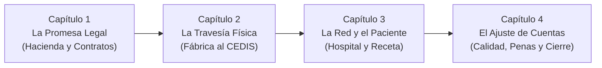

# Guía Maestra de Navegación: El Ecosistema del Abasto de Salud

> **Brújula de Lectura:**
> Si te sientes abrumado por el mar de **12 procesos**, **30 documentos oficiales**, **máquinas de estado**, **algoritmos de mora** y **semáforos de alerta**, este documento es tu **faro y mapa de navegación**.
> Te guiará paso a paso para entender la cadena completa sin perderte en la burocracia ni en el código.

---

## 1. La Gran Historia: El Viaje de una Medicina en 4 Capítulos

Para navegar este mar sin naufragar, piensa en toda la cadena no como trámites aislados, sino como un viaje en **4 actos**:



1. **Capítulo 1: La Promesa Legal (Planeación y Reglas de Juego)**
   El gobierno calcula cuántas medicinas se necesitan, Hacienda aparta el dinero, se hace la licitación y se firma un contrato abierto que compromete al laboratorio a abastecer bajo fianza.
   * *Dónde leerlo:* [PROCESOS_Y_ALERTAS.md (Procesos 1 y 2)](PROCESOS_Y_ALERTAS.md#proceso-1-planeación-y-techo-contractual-laassp-art-47).

2. **Capítulo 2: La Travesía Física y los Filtros Sanitarios (Del Laboratorio al CEDIS)**
   El sistema emite una orden de suministro (OS). El camión viaja con custodia y red fría. Al llegar al andén del almacén central, se enfrenta a 3 pruebas de fuego: papeles en regla (FEUM), temperatura intacta (2°C a 8°C) y caducidad vigente.
   * *Dónde leerlo:* [PROCESOS_Y_ALERTAS.md (Procesos 3, 4 y 5)](PROCESOS_Y_ALERTAS.md#proceso-3-desembarque-y-filtros-sanitarios-en-andén).

3. **Capítulo 3: La Llegada a la Trinchera y el Paciente (Del CEDIS a la Cama del Hospital)**
   El CEDIS distribuye en rutas optimizadas a las 60 clínicas y hospitales. La farmacia local escanea la carga, el médico prescribe y la medicina se entrega en ventanilla, en dosis unitaria para cirugía o se manda a domicilio a enfermos crónicos.
   * *Dónde leerlo:* [PROCESOS_Y_ALERTAS.md (Procesos 6, 7, 8 y 9)](PROCESOS_Y_ALERTAS.md#proceso-6-distribución-secundaria-y-custodia-carretera-hacia-hospitales).

4. **Capítulo 4: El Ajuste de Cuentas (Sanciones, Canjes y Auditoría)**
   ¿El proveedor llegó tarde? Se calcula la mora diaria (2.5%). ¿Alcanzó el 10% de fianza? Se rescinde y entra el segundo lugar. ¿Un lote está por caducar? Se activa el canje a 60 días. ¿Hubo medicina rota o vencida? Se destruye bajo norma ambiental SEMARNAT.
   * *Dónde leerlo:* [CONTRATOS.md (Máquinas de Estado y Fórmulas)](CONTRATOS.md) y [PROCESOS_Y_ALERTAS.md (Procesos 10, 11 y 12)](PROCESOS_Y_ALERTAS.md#proceso-10-farmacovigilancia-y-retiro-de-mercado-cofepris-recall).

---

## 2. Brújula Rápida de Preguntas Frecuentes

Usa esta tabla para saltar exactamente a la respuesta que buscas:

| Si tu duda es... | La respuesta en pocas palabras | Documento y Sección para profundizar |
|---|---|---|
| **¿Cómo se decide cuánta medicina comprar?** | Con el *Dictamen de Presupuesto* y un *Contrato Abierto* (piso obligatorio del 40% y techo del 100%). | [PROCESOS_Y_ALERTAS.md · Proceso 1](PROCESOS_Y_ALERTAS.md#proceso-1-planeación-y-techo-contractual-laassp-art-47) |
| **¿Cuánto tiempo tiene el laboratorio para entregar?** | **15 días naturales** contados a partir del acuse de notificación de la Orden de Suministro. | [PROCESOS_Y_ALERTAS.md · Proceso 2](PROCESOS_Y_ALERTAS.md#proceso-2-detonación-y-cómputo-de-la-orden-de-suministro) |
| **¿Qué pasa si el camión llega con la red fría rota (> 8°C)?** | Se rechaza el lote completo en andén con *Acta Circunstanciada*; no entra al almacén y el proveedor sigue acumulando días de mora. | [PROCESOS_Y_ALERTAS.md · Proceso 3](PROCESOS_Y_ALERTAS.md#proceso-3-desembarque-y-filtros-sanitarios-en-andén) |
| **¿Qué pasa si un contrato trae varios medicamentos y rechazan unos pero aceptan otros?** | **Recepción Mixta:** Se genera EBA Parcial por lo que pasó y Acta de Rechazo por lo que falló. La mora corre **exclusivamente sobre las piezas rechazadas**, y la ley permite **rescindir solo las claves fallidas** pasando al 2° lugar sin cancelar las buenas (Art. 54 Bis). | [CONTRATOS.md · Sección 2.C](CONTRATOS.md#c-la-realidad-operativa-contratos-multipartida-y-recepciones-mixtas) |
| **¿Qué pasa si el proveedor entregó la mitad y luego avisa que ya no puede entregar el resto?** | **Entrega Trunca:** Se le pagan las piezas recibidas reteniendo la penalización por el saldo faltante (**Finiquito Asimétrico**), y el remanente (el 40% faltante) se reasigna inmediatamente al **2° Lugar Licitatorio con una OS de rescate de 5 a 8 días** (Art. 54 Bis). | [CONTRATOS.md · Sección 2.D](CONTRATOS.md#d-incapacidad-manifiesta-de-entrega-de-saldo-la-entrega-trunca) |
| **¿Cómo se guardan las drogas y fentanilo médico?** | En una jaula blindada con control biométrico, recetario especial COFEPRIS y registro ampolleta por ampolleta en libro foliado. | [PROCESOS_Y_ALERTAS.md · Proceso 5](PROCESOS_Y_ALERTAS.md#proceso-5-control-de-estupefacientes-y-psicotrópicos-grupos-i-ii-y-iii) |
| **¿Por qué a veces dicen que "no hay medicina" habiendo cajas guardadas?** | Por el *"medicamento fantasma en pasillo"*: la carga llegó al hospital pero el encargado no la capturó en el sistema kárdex (< 4h). | [PROCESOS_Y_ALERTAS.md · Cuello de Botella 7](PROCESOS_Y_ALERTAS.md#3-radiografía-de-los-12-cuellos-de-botella-dónde-y-por-qué-se-atora) |
| **¿Cómo se castiga a un laboratorio que entrega tarde?** | Se cobra una **Pena Convencional del 1.0% al 2.5% diario** sobre el valor de las piezas que faltaron por entregar (sin IVA). | [CONTRATOS.md · Sección 4](CONTRATOS.md#4-el-ciclo-de-interacción-y-reinicio--cascada-art-54-y-54-bis) |
| **¿Qué pasa si el atraso es tan grave que alcanza el 10% de fianza?** | Se inicia **Rescisión Administrativa (Art. 54)**, se cobra la fianza y **se activa en cascada al 2° lugar licitatorio (Art. 54 Bis)** para que surta el faltante. | [CONTRATOS.md · Sección 2.B y 4](CONTRATOS.md#b-fsm-del-contrato-y-el-nodo-de-rescisiónreinicio) |
| **¿Cómo evitar que la medicina caduque en la farmacia?** | Con la regla de los **60 días**: si faltan 2 meses para caducar y hay stock, se exige al fabricante canjearlo por lote nuevo sin costo. | [PROCESOS_Y_ALERTAS.md · Proceso 11](PROCESOS_Y_ALERTAS.md#proceso-11-vigilancia-de-caducidades-y-garantía-de-canje-60-días) |
| **¿Cómo se destruye la medicina vencida o rota?** | Con un *Acta de Merma* ante el OIC y entrega a una incineradora autorizada por SEMARNAT (NOM-073). | [PROCESOS_Y_ALERTAS.md · Proceso 12](PROCESOS_Y_ALERTAS.md#proceso-12-mermas-destrucción-ecológica-semarnat-y-finiquito) |
| **¿Cómo programar o simular esto como objetos de software?** | Cada contrato, orden y andén tiene su clase (`ContratoAbierto`, `OrdenSuministro`, `RecepcionAnden`) con máquina de estados. | [CONTRATOS.md · Sección 3](CONTRATOS.md#3-definición-de-objetos-para-simulación-estructuras-de-datos) |

---

## 3. Mapa de Relaciones: ¿Qué archivo contiene qué?

Para no confundirte entre los documentos técnicos de este repositorio:

```
                                  MAPA DEL REPOSITORIO
                                            │
        ┌───────────────────┬───────────────┴───────────────┬───────────────────┐
        ▼                   ▼                               ▼                   ▼
[ PROCESOS_Y_ALERTAS ] [ CONTRATOS.md ]            [ ESTRUCTURA_DATOS ]  [ ARQUITECTURA.md ]
  La Vida Real           Modelo de Software          Esquemas JSON/Datos   El Visor 3D Three.js
  ───────────────────    ───────────────────         ───────────────────   ─────────────────────
  • 12 Procesos          • Objetos (Contrato, OS)    • ExpedienteMaestro   • Escena 3D CEDIS
  • 30 Documentos        • Máquinas de Estado (FSM)  • NodoEscritorio      • Mapa de Hidalgo
  • 12 Cuellos Botella   • Algoritmo de Mora 2.5%    • CronometroLegal     • Hospital y Pacientes
  • Matriz Semáforos     • Cascada al 2° Lugar       • CompuertaValidacion • Simulación JS
```

1.  [**`PROCESOS_Y_ALERTAS.md`**](PROCESOS_Y_ALERTAS.md):
    *   **Audiencia:** Administradores, abogados, médicos, planeadores logísticos y directores.
    *   **Contenido:** El mapa forense de la realidad. Explica las leyes mexicanas (LAASSP), las normas sanitarias (FEUM, COFEPRIS), los contratos, los 30 oficios y actas oficiales, y la tabla de semáforos verdes, amarillos, naranjas y rojos con sus tiempos límite (SLAs).
2.  [**`CONTRATOS.md`**](CONTRATOS.md):
    *   **Audiencia:** Diseñadores de software, matemáticos y modeladores.
    *   **Contenido:** Traduce la burocracia a **código de objetos computacionales, clases, propiedades, métodos y máquinas de estados (FSM)**. Explica cómo simular el cálculo de mora diaria y cómo un contrato fallido "reinicia" automáticamente asignando las órdenes al segundo licitante.
3.  [**`ESTRUCTURA_DATOS_BUROCRACIA.md`**](ESTRUCTURA_DATOS_BUROCRACIA.md):
    *   **Audiencia:** Arquitectos de bases de datos, ingenieros de backend y desarrolladores de APIs.
    *   **Contenido:** Especificación formal de esquemas JSON, tipos de datos, capacidad de ventanillas y el motor de eventos discretos para simular el "Expediente Vivo".
4.  [**`ARQUITECTURA.md`**](ARQUITECTURA.md):
    *   **Audiencia:** Desarrolladores web y operadores del gemelo digital.
    *   **Contenido:** Explica cómo funciona el visor web 3D actual ([`index.html`](../web/index.html) para el CEDIS, [`mapa.html`](../web/mapa.html) para el estado de Hidalgo y [`unidad.html`](../web/unidad.html) para los hospitales), sus modelos en Blender y los motores de pronóstico y ruteo en JavaScript.

---

## 4. Guía Visual: La Matriz de Semáforos en una Sola Mirada

Si estás diseñando un tablero de control o monitoreando la operación diaria, estas son las 4 banderas maestras que debes vigilar:

```
┌──────────┬───────────────────────┬────────────────────────────────────────────────────────┐
│ Semáforo │ Significado Operativo │ Disparadores Típicos de Ejemplo                        │
├──────────┼───────────────────────┼────────────────────────────────────────────────────────┤
│ 🟢 VERDE │ Operación Normal      │ • OS en días 1 al 9 de 15.                             │
│          │ (Dentro de SLA)       │ • Temperatura de red fría entre 3.5°C y 6.5°C.         │
│          │                       │ • Caducidad de medicamento ≥ 18 meses.                 │
├──────────┼───────────────────────┼────────────────────────────────────────────────────────┤
│ 🟡 AMAR. │ Alerta Preventiva     │ • OS en día 10 al 13 sin reporte de cita en rampa.     │
│          │ (Desviación temprana) │ • Temperatura rozando límites (2.1°C - 3.4°C o 6.6-7.5)│
│          │                       │ • Medicamento a 80 días de caducar (aviso de canje).   │
├──────────┼───────────────────────┼────────────────────────────────────────────────────────┤
│ 🟠 NAR.  │ Alerta Crítica        │ • OS en días 14 y 15 (a horas de caer en mora).        │
│          │ (Límite de tolerancia)│ • Mercancía lleva 3 horas en pasillo sin alta kárdex.  │
│          │                       │ • Penas acumuladas del proveedor al 7% (tope es 10%).  │
├──────────┼───────────────────────┼────────────────────────────────────────────────────────┤
│ 🔴 ROJO  │ Acción Correctiva     │ • Día 16+: Mora activa; cobro de 2.5% diario (Art. 53).│
│          │ (Sanción o Ruptura)   │ • Ruptura de frío (< 2°C o > 8°C): Rechazo en andén.   │
│          │                       │ • Penas llegan al 10%: Rescisión y cambio a 2° lugar.  │
└──────────┴───────────────────────┴────────────────────────────────────────────────────────┘
```

---

## 5. Recomendación de Ruta de Lectura

Si tienes **15 minutos**:
1. Lee este documento ([`GUIA_DE_NAVEGACION.md`](GUIA_DE_NAVEGACION.md)).
2. Revisa la tabla de semáforos de la Sección 4 de [PROCESOS_Y_ALERTAS.md](PROCESOS_Y_ALERTAS.md#4-matriz-maestra-de-monitoreo-semáforos-slas-y-disparadores).

Si tienes **1 hora**:
1. Lee completo [PROCESOS_Y_ALERTAS.md](PROCESOS_Y_ALERTAS.md) para dominar la cadena completa, los 30 documentos y los 12 cuellos de botella.
2. Lee la Sección 2 y 4 de [CONTRATOS.md](CONTRATOS.md) para comprender la máquina de estados y la cascada al segundo licitante.

Si vas a **construir el backend o base de datos**:
1. Estudia a fondo las clases y diagramas de estados de [CONTRATOS.md](CONTRATOS.md#3-definición-de-objetos-para-simulación-estructuras-de-datos).
2. Consulta el esquema relacional SQL en la memoria del experto de NotebookLM y el endpoint de andén.
