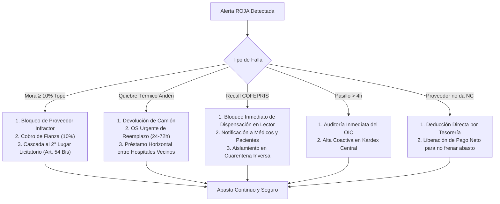

# Mapa Maestro de Procesos, Ciclo Documental y Matriz de Alertas Tempranas (Abasto de Salud)

Este documento contiene la investigación exhaustiva y definitiva del **ciclo de vida integral de los procesos, el inventario documental completo (30 documentos oficiales), los 12 cuellos de botella ("atorones") y la matriz de monitoreo/alertas (SLAs)** en la cadena de abasto del sector salud público mexicano (IMSS, ISSSTE, Birmex, IMSS-Bienestar y Secretaría de Salud).

---

## 1. El Mapa del Ciclo Documental de Punta a Punta (30 Documentos Oficiales)

Para que un medicamento ordinario, de red fría o un estupefaciente controlado viaje de la planta del laboratorio a las manos del paciente, y posteriormente cierre su ciclo contable, ambiental y de farmacovigilancia, la normativa mexicana exige **30 documentos oficiales**:

```mermaid
flowchart LR
    subgraph Fase1 ["I. Formalización"]
        D1["1. Dictamen Presupuestal"]
        D2["2. Fallo de Licitación"]
        D3["3. Contrato Abierto"]
        D4["4. Póliza de Fianza"]
        D5["5. Opinión Positiva SAT"]
    end
    subgraph Fase2 ["II. Requerimiento"]
        D6["6. Orden de Suministro (OS)"]
        D7["7. Acuse Notificación OS"]
        D8["8. Dictamen de Prórroga"]
    end
    subgraph Fase3 ["III. Andén y Calidad"]
        D9["9. Remisión de Embarque"]
        D10["10. Certificado FEUM"]
        D11["11. Data-Logger Red Fría"]
        D12["12. Carta Canje 100%"]
        D13["13. Entrada de Almacén (EBA)"]
        D14["14. Acta de Rechazo"]
        D15["15. Dictamen Liberación Cuarentena"]
    end
    subgraph Fase4 ["IV. Controlados"]
        D16["16. Recetario Especial COFEPRIS"]
        D17["17. Libro Foliado de Controlados"]
    end
    subgraph Fase5 ["V. Tránsito y Hospital"]
        D18["18. Vale Traspaso (VTI)"]
        D19["19. Acta Discrepancia Tránsito"]
        D20["20. Recepción Hospitalaria"]
    end
    subgraph Fase6 ["VI. Paciente y Farmacovigilancia"]
        D21["21. Receta Médica / Colectivo"]
        D22["22. Vale por Desabasto"]
        D23["23. Comprobante QR Entrega"]
        D24["24. Formato RAM COFEPRIS"]
        D25["25. Alerta Sanitaria de Retiro"]
    end
    subgraph Fase7 ["VII. Cierre, Canje y Disposición"]
        D26["26. Factura CFDI SAT"]
        D27["27. Cédula de Penas (Art. 53)"]
        D28["28. Nota de Crédito (NC)"]
        D29["29. Acta de Destrucción Merma"]
        D30["30. Manifiesto Residuos SEMARNAT"]
    end

    Fase1 --> Fase2 --> Fase3 --> Fase4 --> Fase5 --> Fase6 --> Fase7
```



### Tabla Exhaustiva de los 30 Documentos Oficiales

| # | Documento Oficial | Emisor | Receptor | Función Crítica y Requisito de Validez |
|---|---|---|---|---|
| **1** | **Dictamen de Disponibilidad Presupuestal** | Finanzas / SHCP | Área Contratante | Certifica suficiencia líquida antes de licitar. Sin él, la compra es nula de pleno derecho. |
| **2** | **Acta de Fallo de Licitación** | Convocante | Licitantes | Acto administrativo público que adjudica la clave y fija el precio unitario inamovible. |
| **3** | **Contrato Abierto de Suministro** | Dirección Jurídica | Proveedor Adjudicado | Instrumento rector (Art. 47 LAASSP). Fija piso obligatorio (≥40%) y techo legal (100%). |
| **4** | **Póliza de Fianza de Cumplimiento** | Afianzadora autorizada | Dependencia Pública | Garantiza el 10% del monto máximo contratado sin IVA (tope de penalización legal). |
| **5** | **Opinión de Cumplimiento SAT (32-D)** | SAT | Área Contratante | Constancia positiva de no adeudo fiscal previa a la firma del contrato y a cada pago. |
| **6** | **Orden de Suministro (OS)** | Subdirección de Abasto | Proveedor | Solicitud formal de entrega con folio único, clave CNIS (12 dígitos), lote y cantidad. |
| **7** | **Acuse de Notificación Electrónica** | Sistema Oficial (SIAB/SICORA) | Proveedor | Estampa de tiempo legal fehaciente; **inicia el cómputo de 10 a 15 días naturales**. |
| **8** | **Dictamen de Prórroga** | Administrador de Contrato | Proveedor | Autorización excepcional por fuerza mayor antes del vencimiento (Art. 91 RLAASSP). |
| **9** | **Remisión de Embarque Valorizada** | Laboratorio / Distribuidor | Almacén Central (CEDIS) | Manifiesto de carga que desglosa piezas, bultos y lotes físicos transportados. |
| **10** | **Certificado Analítico de Calidad** | Responsable Sanitario (Fabricante) | Control de Calidad | Avala pruebas fisicoquímicas/microbiológicas por lote conforme a la FEUM. |
| **11** | **Gráfica de Data-Logger Térmico** | Dispositivo IoT en furgón | Almacén Central | Acredita que el lote termolábil no salió de **2°C a 8°C** durante el transporte. |
| **12** | **Carta Compromiso de Canje al 100%** | Fabricante / Distribuidor | Almacén Central | Respaldo para insumos con vida útil entre 12 y 18 meses (garantiza canje si no se consumen). |
| **13** | **Entrada de Bienes al Almacén (EBA)** | Jefe de Almacén | Proveedor / Finanzas | **Acta de nacimiento del inventario institucional**; ampara la recepción legal a satisfacción. |
| **14** | **Acta Circunstanciada de Rechazo** | Comité de Andén | Proveedor / OIC | Instrumento jurídico que detalla el rechazo por temperatura, caducidad o falta de FEUM. |
| **15** | **Dictamen de Liberación de Cuarentena** | Responsable Sanitario de Almacén | Sistema WMS | Desbloquea el lote en el sistema para permitir su surtido y picking a hospitales. |
| **16** | **Recetario Especial con Código Bidimensional** | COFEPRIS | Médico Especialista | Formato oficial para prescribir estupefacientes (Grupo I, Ley General de Salud). |
| **17** | **Libro de Control de Estupefacientes** | Farmacia / Almacén | Inspección COFEPRIS | Libro empastado, foliado y sellado para registrar entradas y salidas ampolleta por ampolleta. |
| **18** | **Vale de Transferencia Interna (VTI)** | CEDIS Central | Camión de Enlace | Ampara el traslado carretero entre almacén central y almacén hospitalario. |
| **19** | **Acta de Discrepancia en Tránsito** | Receptor Hospital / Chofer | Logística / Jurídico | Ampara bultos rotos, faltantes o sellos violados al abrir el camión en destino. |
| **20** | **Constancia de Recepción Hospitalaria** | Farmacia del Hospital | Logística Estatal | Firma de recepción física en la unidad médica y alta inmediata en el kárdex local. |
| **21** | **Receta Médica Oficial / Colectivo** | Médico Tratante | Farmacia / Enfermería | Prescripción con cédula, diagnóstico CIE y firma; autoriza la salida al paciente. |
| **22** | **Vale de Canje por Desabasto** | Farmacia de Unidad | Paciente | Comprobante emitido al derechohabiente cuando la receta no pudo ser surtida. |
| **23** | **Comprobante de Entrega Última Milla** | Mensajero / Casillero | Sistema / Paciente | Código QR firmado o biometría de entrega en casillero o domicilio. |
| **24** | **Notificación de RAM (Farmacovigilancia)** | Comité de Farmacovigilancia | COFEPRIS / CNFV | Reporte de Reacción Adversa o falla terapéutica detectada en un paciente. |
| **25** | **Alerta Sanitaria de Retiro (Recall)** | COFEPRIS | Red Hospitalaria | Orden vinculante para inmovilizar cautelarmente un lote en toda la red hospitalaria. |
| **26** | **Factura Electrónica (CFDI con XML)** | Proveedor (SAT) | Ventanilla de Cuentas por Pagar | Factura fiscal timbrada que debe cuadrar idénticamente con la EBA y la OS. |
| **27** | **Cédula de Cálculo de Penas** | Contabilidad / Abasto | Proveedor | Liquidación matemática de días de atraso (1.0% a 2.5% diario) según Art. 53 LAASSP. |
| **28** | **Nota de Crédito (NC)** | Proveedor | Finanzas Institucional | Descuento fiscal emitido por el proveedor para saldar la penalización por mora. |
| **29** | **Acta de Destrucción de Mermas** | Comité Hospitalario / OIC | Finanzas / Contabilidad | Instrumento notariado para dar de baja legal del patrimonio medicamentos caducos o mermados. |
| **30** | **Manifiesto de Residuos Peligrosos** | Empresa Incineradora Autorizada | SEMARNAT / Dependencia | Constancia de transporte y disposición final ambiental (NOM-073-SEMARNAT-SSA1). |

---

## 2. Los 12 Procesos Fundamentales Paso a Paso

```
 [1. CONTRATACIÓN] ──► [2. ORDENAMIENTO] ──► [3. ANDÉN CEDIS] ──► [4. CUARENTENA]
                                                                        │
 ┌──────────────────────────────────────────────────────────────────────┘
 │
 ▼
 [5. CONTROLADOS]  ──► [6. DISTRIBUCIÓN] ──► [7. FARMACIA HOSP] ──► [8. DISPENSACIÓN]
                                                                        │
 ┌──────────────────────────────────────────────────────────────────────┘
 │
 ▼
 [9. ÚLTIMA MILLA] ──► [10. VIGILANCIA/RECALL] ──► [11. CANJE 60D] ──► [12. MERMA/PAGO]
```

### Proceso 1: Planeación y Techo Contractual (LAASSP Art. 47)
1. **Consolidación:** Se calcula la Demanda Promedio Mensual (DPM) de cada hospital y se integra el requerimiento consolidado.
2. **Suficiencia:** Finanzas sella el *Dictamen de Disponibilidad Presupuestal*.
3. **Adjudicación:** Se emite el *Acta de Fallo*.
4. **Firma y Garantía:** En los 15 días posteriores al fallo se formaliza el *Contrato Abierto* y el proveedor entrega la *Póliza de Fianza* (10% del monto máximo). El contrato opera con piso obligado del 40% y techo del 100% (+20% convenio modificatorio Art. 52).

### Proceso 2: Detonación y Cómputo de la Orden de Suministro
1. **Disparo por Reorden:** El sistema detecta que los Días de Inventario Disponible (DID) caen por debajo de la existencia de seguridad.
2. **Validación de Techo:** El sistema verifica que la nueva OS no rebase el saldo disponible de la clave adjudicada.
3. **Emisión y Notificación:** Se genera la OS en el sistema oficial y se envía al proveedor con acuse digital fehaciente.
4. **Cómputo de Cumplimiento:** A partir del día natural siguiente al acuse corren **15 días naturales** para la entrega física en andén.

### Proceso 3: Desembarque, Recepciones Mixtas y Filtros Sanitarios en Andén
1. **Arribo:** El camión del laboratorio se posiciona en rampa del CEDIS con un embarque que habitualmente contiene **múltiples claves (contrato multipartida)**.
2. **Inspección Independiente Clave por Clave:** El verificador no emite un dictamen global para todo el camión; evalúa cada partida de forma quirúrgica:
   * **Partidas Aceptadas al 100%:** Cumplen remisión, FEUM y red fría $\rightarrow$ Se les genera **Entrada de Bienes al Almacén (EBA Parcial)** e ingresan a stock.
   * **Partidas Aceptadas Condicionadas:** Caducidad entre 12 y 18 meses $\rightarrow$ Ingresan con marca de *Carta Canje al 100%*.
   * **Partidas Rechazadas por Red Fría (< 2°C o > 8°C):** Se levanta *Acta Circunstanciada de Rechazo Parcial*, las cajas se devuelven físicamente en el camión y esa partida específica continúa acumulando días de atraso en el reloj de mora.
   * **Partidas Rechazadas por Falta de FEUM o Marbete:** Mercancía devuelta o en depósito provisional; mora activa para esa clave.
   * **Entregas Parciales (volumen incompleto):** Se genera EBA por las piezas recibidas; el saldo faltante corre mora diaria del 2.5%.
3. **Efecto Administrativo:** Se emite simultáneamente una **EBA Parcial** (por lo que sí pasó) y una o varias **Actas de Rechazo Parcial** (por lo que no pasó). El proveedor solo podrá facturar lo amparado en la EBA Parcial.

### Proceso 4: Cuarentena Sanitaria y Liberación de Lote (WMS Quality Hold)
1. **Aislamiento en WMS:** Aunque la mercancía ya está en el CEDIS, el sistema la ingresa en estado `CUARENTENA_CALIDAD` (bloqueada para picking).
2. **Muestreo:** El personal de control de calidad toma muestras aleatorias conforme a la tabla militar estándar (MIL-STD-105E).
3. **Dictamen de Liberación:** Al validar atributos organolépticos y hermeticidad de empaque, el Responsable Sanitario firma el *Dictamen de Liberación de Cuarentena*, cambiando el lote a `DISPONIBLE`.

### Proceso 5: Control de Estupefacientes y Psicotrópicos (Grupos I, II y III)
1. **Resguardo de Máxima Seguridad:** Ingreso a la Jaula de Controlados con acceso biométrico exclusivo del Responsable Sanitario.
2. **Asiento en Libros COFEPRIS:** Se registra en el *Libro Foliado y Sellado por COFEPRIS* el número de lote, fecha de ingreso, laboratorio productor y cantidad exacta de ampolletas.
3. **Conteos Ciegos Semanales:** Conciliación física ampolleta por ampolleta contra el saldo del libro oficial. La discrepancia de una sola ampolleta activa denuncia inmediata ante el Ministerio Público Federal.

### Proceso 6: Distribución Secundaria y Custodia Carretera hacia Hospitales
1. **Picking y Consolidación:** En el CEDIS se arman las tarimas o cajas colectivas para cada una de las 60 unidades.
2. **Emisión de Guía y Marchamo:** Se genera el *Vale de Transferencia Interna (VTI)* y se coloca un sello satelital o marchamo de seguridad foliado en la puerta del furgón.
3. **Tránsito:** Camionetas recorren las rutas optimizadas con monitoreo GPS y sensor de apertura de puertas.
4. **Desembarque:** En el hospital, el chofer y el encargado verifican que el marchamo esté intacto. Si está violado o hay cajas rotas, se levanta *Acta de Discrepancia en Tránsito*.

### Proceso 7: Recepción Hospitalaria y Kárdex Local
1. **Escaneo en Farmacia:** El jefe de farmacia escanea los bultos con lectura Datamatrix a ciegas.
2. **Constancia:** Firma la *Constancia de Recepción Hospitalaria*.
3. **Carga en Kárdex:** El stock ingresa inmediatamente al sistema hospitalario local para que los médicos en consultorio puedan visualizar disponibilidad.

### Proceso 8: Prescripción, Validación Farmacéutica y Dispensación
1. **Prescripción:** El médico tratante genera la *Receta Médica Oficial* (o *Recetario Especial COFEPRIS* si es estupefaciente).
2. **Validación Farmacéutica:** En hospitalización, el farmacéutico clínico valida dosis, interacciones y contraindicaciones antes del surtido.
3. **Dispensación en Ventanilla:**
   * Surtido Completo: Se entrega el medicamento y se descuenta del inventario local.
   * Surtido Parcial / Negado: El sistema emite automáticamente el *Vale por Desabasto* y levanta una alerta de pedido extraordinario al CEDIS.
4. **Dosis Unitaria en Piso/Quirófano:** La enfermera solicita el medicamento mediante formato *Colectivo*; al administrarlo en la cama, escanea la ampolleta y el brazalete del paciente.

### Proceso 9: Logística de Última Milla (Pacientes Crónicos)
1. **Inscripción:** Pacientes crónicos estables (diabetes, hipertensión) con receta resurtible trimestral.
2. **Vías de Entrega:** Asignación a casillero inteligente 24 h, punto aliado o envío a domicilio en moto repartidora.
3. **Comprobante Seguro:** El paciente valida la recepción mediante escaneo de código QR único o autenticación biométrica en el casillero.

### Proceso 10: Farmacovigilancia y Retiro de Mercado (COFEPRIS Recall)
1. **Detección de Anomalía:** Se reporta una sospecha de Reacción Adversa o defecto de calidad mediante el *Formato RAM COFEPRIS*.
2. **Emisión de Alerta Sanitaria:** COFEPRIS emite oficio de retiro cautelar de un lote.
3. **Bloqueo en Cascada:** Al ingresar el número de lote al sistema, este se **bloquea instantáneamente en las 60 unidades médicas**: el lector de farmacia rechaza su dispensación y el sistema alerta a los médicos.
4. **Logística Inversa:** Se recoge el lote de los anaqueles y se resguarda en cuarentena para su devolución al fabricante.

### Proceso 11: Vigilancia de Caducidades y Garantía de Canje (60 Días)
1. **Monitoreo Automático:** El sistema hospitalario escanea permanentemente las fechas de caducidad.
2. **Alerta de 60 Días:** Si un lote que ingresó con *Carta Canje* llega a **60 días antes de su vencimiento**, el sistema emite automáticamente el *Oficio de Notificación de Canje*.
3. **Sustitución por Fabricante:** El proveedor tiene **15 días naturales** para recoger el medicamento y entregar un lote nuevo con vigencia mayor a 18 meses.
4. **Sanción por Omisión:** Si el proveedor no se presenta, se aplica deducción directa (10%) sobre contra-recibos.

### Proceso 12: Mermas, Destrucción Ecológica (SEMARNAT) y Finiquito
1. **Dictamen de Merma:** Insumos rotos, contaminados o vencidos no canjeables son declarados pérdida en un *Acta de Destrucción de Mermas* firmada ante el Órgano Interno de Control (OIC).
2. **Disposición Final:** Entrega a empresa autorizada con *Manifiesto de Residuos Peligrosos (SEMARNAT)* para incineración ecológica conforme a la NOM-073-SEMARNAT-SSA1.
3. **Conciliación Financiera:** El área de finanzas aplica el cobro de penas mediante *Nota de Crédito*, liquida facturas pendientes y emite el *Finiquito de Cancelación de Fianza*.

---

## 3. Radiografía de los 12 Cuellos de Botella ("Dónde y por qué se atora")

```
 1. Disputa Notificación OS (Falta de acuse claro)
 2. Falta de Certificado FEUM en Andén
 3. Excursión Térmica en Rampa (> 8.0°C)
 4. Cuarentena Indefinida sin Muestreo Rápido
 5. Descuadre en Libro de Controlados (Jaula parada)
 6. Rotura de Marchamo en Carretera (Sospecha de robo)
 7. Mercancía en Pasillo (Retenida sin kárdex)
 8. Receta Negada sin Vale de Desabasto Automático
 9. Lote con Alerta COFEPRIS sin Bloqueo Inmediato
10. Omisión de Reclamo de Canje a 60 Días
11. Resistencia del Proveedor a emitir Nota de Crédito
12. Parálisis Administrativa por Alcance del Tope del 10%
```

| # | Cuello de Botella | Causa Raíz Administrativa / Operativa | Efecto Real en la Operación |
|---|---|---|---|
| **1** | **Discrepancia en Notificación OS** | Abasto emite la OS el viernes pero la notifica el martes. Disputa sobre cuándo inician los 15 días. | El laboratorio retrasa la producción; el almacén pretende penalizarlo y la mercancía no sale. |
| **2** | **Camión Varado en Andén** | El transportista llega sin el Certificado Analítico FEUM o sin la leyenda *"Propiedad del Sector Salud"*. | El almacén rechaza el embarque; el camión queda días en patio detonando mora innecesaria. |
| **3** | **Cuarentena Fría por Excursión** | Espera prolongada bajo el sol en la puerta del CEDIS; el sensor marca 8.4°C por 20 minutos. | El lote queda congelado jurídicamente; insulinas o vacunas no se pueden usar ni devolver. |
| **4** | **Traba en Liberación de Lote** | El laboratorio de control de calidad tarda semanas en muestrear la carga descargada. | La medicina está físicamente en el rack pero el WMS la mantiene en "Quality Hold" inaccesible. |
| **5** | **Discrepancia en Controlados** | Una ampolleta de fentanilo rota en desembarque no se documentó en el Libro COFEPRIS al instante. | Se suspende el surtido de toda la jaula de anestesia hasta conciliar libros y dar vista al MP. |
| **6** | **Ruptura de Sello Carretero** | El camión de enlace llega a la clínica con el marchamo roto o discrepancia en número de bultos. | El hospital rechaza descargar la camioneta; sospecha de robo o desvío en ruta. |
| **7** | **Medicamento Fantasma en Pasillo** | Se descargan 100 cajas en el hospital el viernes pero el personal no las captura en kárdex hasta el martes. | Los médicos ven "0 existencias" en sistema y mandan al paciente a comprar afuera con cajas en pasillo. |
| **8** | **Fuga de Paciente sin Vale** | La farmacia no tiene el fármaco pero no expide el Vale de Desabasto oficial por pereza administrativa. | El sistema central nunca se entera del desabasto; el paciente queda desatendido sin registro. |
| **9** | **Dispensación de Lote con Recall** | COFEPRIS emite alerta sanitaria pero la circular en papel tarda días en llegar a las clínicas. | Se siguen administrando medicamentos contaminados a pacientes por falta de bloqueo informático. |
| **10**| **Pérdida por Canje Omitido** | La farmacia no revisa caducidades a 60 días; solicitan el canje a 1 semana del vencimiento. | El laboratorio se niega legalmente al canje; el medicamento se convierte en merma para el Estado. |
| **11**| **Factura Congelada por Mora** | Finanzas calcula pena de $100k; el proveedor objeta el monto y no emite la Nota de Crédito. | Se congela el pago total ($1.5 MDP); el proveedor corta el suministro de otras claves en represalia. |
| **12**| **Parálisis por Tope de Fianza (10%)** | El proveedor acumula 4 días de mora y alcanza el 10%. Entra en litigio de rescisión (Art. 54). | Durante 45 días el contrato queda congelado sin entregas y sin poder reasignar el presupuesto. |

---

## 4. Matriz Maestra de Monitoreo: Semáforos, SLAs y Disparadores

```
 🟢 VERDE    : Dentro de SLA (Operación normal).
 🟡 AMARILLO : Alerta Preventiva (Desviación temprana, < 20% del margen).
 🟠 NARANJA  : Alerta Crítica (SLA superado; requiere intervención inmediata del Administrador).
 🔴 ROJO     : Ruptura / Sanción Activa (Mora legal, quiebre térmico, bloqueo o rescisión).
```

### Matriz Completa de Reglas de Disparo y SLAs

| # | Proceso / Punto de Control | SLA Estándar | 🟢 VERDE | 🟡 AMARILLO (Preventivo) | 🟠 NARANJA (Crítico) | 🔴 ROJO (Acción Correctiva) |
|---|---|---|---|---|---|---|
| **1** | **Acuse Notificación OS** | **24 horas** tras emitir | Acuse firmado < 12 h | 12 a 20 h sin confirmación | 20 a 24 h sin acuse digital | **> 24 h:** Apercibimiento legal automático a representante. |
| **2** | **Arribo a Andén (Mora)** | **15 días** naturales | Días 1 al 9 (En tiempo) | Días 10 a 13 sin cita en rampa | Días 14 y 15 sin camión reportado | **Día 16+:** Disparo de cálculo de Pena Convencional diaria (2.5%). |
| **3** | **Sensor Térmico en Tránsito** | **2.0°C a 8.0°C** | 3.5°C a 6.5°C | 2.1°C - 3.4°C / 6.6°C - 7.5°C | 7.6°C - 7.9°C / 2.01°C - 2.09°C | **< 2.0°C o > 8.0°C:** Bloqueo de rampa, rechazo físico y Acta. |
| **4** | **Liberación de Cuarentena** | **48 horas** en CEDIS | Dictamen < 24 h | 24 a 36 h en Quality Hold | 36 a 48 h sin muestreo | **> 48 h:** Alerta de parálisis de inventario al Responsable Sanitario. |
| **5** | **Conciliación Controlados** | **Diario / Semanal** | Cero discrepancias | Retraso de 2 h en cierre diario | Retraso > 4 h en registro de ampolleta | **Discrepancia > 0 piezas:** Bloqueo de jaula y aviso a MP Federal. |
| **6** | **Tránsito a Hospital** | **Horario de Ruta (8h)** | Arribo en ventana prevista | Desvío de ruta > 15 minutos | Retraso de arribo > 1 hora | **Sello roto / Faltante:** Levantamiento de Acta de Discrepancia. |
| **7** | **Captura en Kárdex Hospital**| **4 horas** tras descarga | Alta en sistema < 2 h | 2 a 3 h sin captura | 3 a 4 h (Mercancía en pasillo) | **> 4 h:** Alerta de auditoría al Director y al OIC por retención. |
| **8** | **Tiempo de Espera en Farmacia**| **≤ 20 minutos** | Espera < 10 min | 11 a 15 min en fila | 16 a 20 min | **> 20 min:** Activación de ventanilla de refuerzo y casillero. |
| **9** | **Alerta Recall COFEPRIS** | **Inmediato (Minutos)** | Sin alertas activas | Notificación recibida en revisión | Lote identificado en red | **Tiempo de bloqueo > 15 min:** Bloqueo forzoso central en 60 clínicas. |
| **10**| **Vigilancia de Canje** | **60 días** antes de caducar| > 90 días de vigencia | Día 89 a 65 (Aviso preventivo) | Día 64 a 60 (Emisión obligatoria) | **Día 59 o menos:** Alerta roja por riesgo de pérdida patrimonial. |
| **11**| **Sustitución por Canje** | **15 días** naturales | Canje completado < 7 d | Días 8 a 11 sin recolección | Días 12 a 14 sin nuevo lote | **Día 15+:** Ejecución de deducción del 10% en contra-recibos. |
| **12**| **Tope de Fianza (10%)** | **Tope: 10%** del contrato | Penas = 0% a 3% fianza | Penas = 3.1% a 6.0% fianza | Penas = 6.1% a 9.9% (Alerta urgente)| **Pena ≥ 10%:** Procedimiento de **Rescisión (Art. 54)**. |
| **13**| **Emisión Nota de Crédito** | **5 días** hábiles tras EBA| NC recibida < 3 d | Día 4 sin respuesta de proveedor | Día 5 sin timbrado de NC | **Día 6+:** Congelamiento de trámites de pago y retención líquida. |

---

## 5. Protocolo de Desbloqueo y Rescate del Abasto



1. **Desbloqueo ante Rescisión (Art. 54 y 54 Bis):** En lugar de esperar 45 días de litigio burocrático, el sistema dispara automáticamente la consulta a la base de licitación, extrae la cotización del **Licitante Segundo Lugar** y emite la orden de rescate en máximo 5 días.
2. **Desbloqueo ante Rechazo Sanitario en Andén:** El sistema activa de inmediato una **orden de redistribución horizontal (préstamo entre unidades médicas vecinas con stock holgado)** para abastecer pacientes mientras el laboratorio repone el lote rechazado.
3. **Desbloqueo ante Recall Sanitario COFEPRIS:** El sistema transmite la orden de bloqueo a los lectores láser de farmacia en menos de 1 segundo. Si un despachador intenta pasar una caja del lote contaminado, el lector emite un pitido de error y bloquea el sistema.
4. **Desbloqueo ante Mercancía Oculta en Pasillo:** Tras 4 horas de descarga sin captura en kárdex, se notifica al Órgano Interno de Control (OIC), lo que fuerza al personal administrativo a dar de alta los insumos inmediatamente.
5. **Desbloqueo Financiero:** Si el proveedor no timbra la Nota de Crédito por penas en 5 días, Tesorería aplica la deducción líquida directa y libera el remanente de la factura para que el proveedor mantenga flujo de producción.
