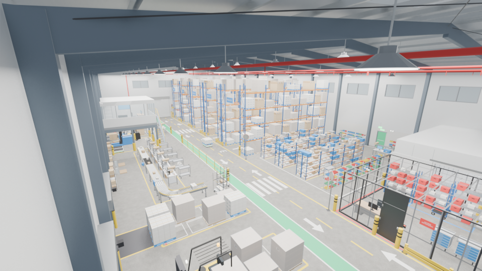

# Gemelo digital del abasto de medicamentos · Hidalgo

**Autor:** Gersain Barron · [Licencia MIT](LICENSE)

Gemelo digital de la cadena de abasto de medicamentos de las unidades **IMSS e ISSSTE de Hidalgo**: del almacén
central (CEDIS) a las 60 unidades médicas y de ahí al paciente. Combina modelos 3D construidos con código en
**Blender**, un visor web en **three.js** que funciona en PC y en iPad, y una simulación determinista de la operación
diaria (recetas, cirugías, inventario, rutas, alertas, pedidos y entregas).

El trabajo está organizado según la hoja de ruta del Consejo Asesor:

| Hoja de ruta oficial | Qué hace el gemelo digital |
|---|---|
| **Meta 1.** Minimizar costos de distribución (rutas óptimas) | Optimizador de rutas con modelo de costos: −20 % en la semana, 15 → 10 viajes, 709 km menos |
| **Meta 2.** Asignación eficiente según demanda real e inventario | Inventario del CEDIS por clave y lote; asignación que iguala días de cobertura con prioridad VEN |
| **Meta 3.** Predicción de demanda | Holt-Winters con estacionalidad semanal y tendencia amortiguada, precisión de ~95 % a nivel estatal |
| **Proyecto 1.** Solicitud de necesidades en tiempo real | Alertas de las unidades al CEDIS y pedido automático antes del desabasto, con flujo de aprobación |
| **Proyecto 2.** Gestión de almacén e inventarios | CEDIS 3D, inventario por clave y lote, PEPS, caducidades, trazabilidad y almacén regional tipo |
| **Proyecto 3.** Logística de última milla | Rutas del CEDIS a las unidades, y de la unidad al paciente (casillero 24 h, punto aliado y domicilio en moto) |

> **Datos.** Las 60 unidades vienen del catálogo CLUES (DGIS, agosto 2026) y las 60 claves del
> Compendio Nacional de Insumos para la Salud (CNIS). **Todo lo operativo es simulado**: existencias,
> recetas, pacientes, rutas, tiempos y costos. Ver [docs/DATOS.md](docs/DATOS.md).



## Las vistas

| Vista | Archivo | Qué muestra |
|---|---|---|
| **Torre de control** | `web/torre.html` | La vista del "jefe de jefes": corre todos los gemelos con un escenario (normal, proveedor que falla, huracanes, compra tardía) y los resume en 10 eslabones y 36 indicadores, cada uno con meta, fuente y un solo dueño. Dice de quién es el problema (con atribución al eslabón de arriba), a quién llamar hoy con su nivel de escalamiento, los nombres concretos detrás y el semáforo de las 32 delegaciones. Pestaña 3D con una torre vigía cuyo ojo patrulla los focos rojos del país. Detalle en [docs/TORRE.md](docs/TORRE.md) |
| **Planeación** | `web/planeacion.html` | Módulo 1 de la plataforma homologada: planes de necesidad, catálogos de unidades, insumos y kits, asignación por Oficina Central (propuesta por pronóstico), aprobación Unidad → Delegación → Oficina Central con aprobar, rechazar o negociar, programas especiales, cierre por el firmante y notificaciones. Se actúa con cualquier rol y una simulación hace responder a las 1,033 unidades y 32 delegaciones. Detalle en [docs/PLANEACION.md](docs/PLANEACION.md) |
| **Compras** | `web/compras.html` | Compra consolidada del plan al contrato: con la demanda del plan anual, simula la licitación (patente y fuente única, evaluación binaria, precio no aceptable y no conveniente, ofertas de descuento, hasta 4 fuentes por clave), las claves desiertas y su segunda vuelta, la firma, las primeras entregas y las rescisiones de 2027. Embudo de piezas, calendario contra el 1 de enero, causas de desiertas, proveedores, tabla por clave y comparación de estrategias. Detalle en [docs/COMPRAS.md](docs/COMPRAS.md) |
| **CEDIS 3D** | `web/index.html` | Almacén con montacargas, AGV y picking animados. Pestañas: entradas, salidas, unidades, urgencias, inventario y bandeja de autorización. Capas de ocupación y de cobertura por clave |
| **Red estatal** | `web/mapa.html` | Mapa de Hidalgo con semáforo de las 60 unidades, camionetas en ruta, desabasto, rutas y costos, inventario y asignación, alertas, redistribución, trazabilidad de lotes y pronóstico |
| **CENADI · Entradas y salidas** | `web/cenadi.html` | Centro Nacional de Distribución en 3D: proveedores con o sin cita, caseta, patio, andenes, carritos de descarga, cuarentena, subida a rack, picking, carriles y carga de la flota. Panel "Dónde se atrasa" por etapa, 8 indicadores, Gantt de andenes, colas, agenda y comparación de 9 escenarios |
| **Red nacional** | `web/nacional.html` | Mapa 3D de México por estado con el CENADI al centro: arcos de flujo con grosor por tarimas, tráileres en ruta, color por cobertura, abasto o unidades. Al tocar un estado se levanta, brilla y muestra su ficha: unidades ISSSTE por nivel de atención (CLUES ago 2026), existencia, cobertura, embarques en camino y la gráfica de 30 días. Mosaico de 32 estados, carga diaria del CENADI, tabla con CSV, bitácora y 5 escenarios × 2 reglas de reparto |
| **Red fría** | `web/redfria.html` | Temperatura cada 5 minutos de 1,066 equipos (cámara del CENADI, 32 almacenes estatales y el refrigerador de cada unidad) y de cada tráiler y caja térmica durante 30 días. Cadena en 3D que sigue el producto de una unidad, curva de 30 días, mapa de equipos, bitácora de excursiones (detectadas o no), tabla por estado y comparación de inversiones con su retorno |
| **Unidad médica** | `web/unidad.html` | Hospital 3D con pacientes y enfermeras: al tocar a una persona se ven sus medicamentos. Incluye indicadores, recetas completas, parciales y negadas, 60 claves con kárdex, lotes y pronóstico, alertas, pedidos extraordinarios y entregas a pacientes |

Las tres vistas usan la misma simulación determinista, así que una alerta que ve la unidad en el iPad es la misma
que ve el CEDIS en la PC, sin un servidor que las conecte.

## Cómo correrlo

```bash
cd web
python serve.py          # o doble clic en serve.bat (Windows)
```

- **PC:** `http://localhost:8080`
- **iPad (misma red Wi-Fi):** la dirección `http://192.168.x.x:8080` que muestra la ventana del servidor.
  Para usarlo como app: Safari → Compartir → *Agregar a pantalla de inicio*.

No requiere internet ni instalación: three.js y el generador de QR están en `web/vendor/`.

Parámetros de la URL, compartidos por las tres vistas:

| Parámetro | Valores | Efecto |
|---|---|---|
| `esc` | `normal` · `contingencia` | Contingencia: el CEDIS se queda sin 6 claves y con existencia parcial de 4, y hay brote respiratorio |
| `pol` | `minmax` · `forecast` | Método de pedido del CEDIS al proveedor |
| `ped` | `0` | Apaga el pedido automático, para comparar |
| `u` | CLUES | Unidad que abre `unidad.html` |
| `t` | segundos | Instante de la simulación (día 0 = lunes 26 oct 2026) |

## Resultados de la simulación

| Fase | Indicador | Antes | Después |
|---|---|---|---|
| 1 · Rutas | Costo de distribución de la semana | $50,103 | $39,939 (−20 %) |
| 2 · Pedido del CEDIS por pronóstico | Nivel de servicio del CEDIS (90 días) | 97.5 % | 99.6 % |
| | Días-clave sin existencia | 16 | 1 |
| | Inventario promedio | 27.6 días | 20.4 días |
| 3 · Pedido automático en unidades | Alertas por clave agotada (30 días, red) | 334 | 38 |
| | Recetas surtidas completas | 99.1 % | 99.9 % |
| | Recetas completas en contingencia | 96.4 % | 97.9 % |
| 4 · Última milla (HGZMF 1, 30 días) | Visitas a farmacia evitadas | — | 364 |
| | Horas de pacientes ahorradas | — | ~529 |
| | Costo por entrega a domicilio | — | ~$47 |
| 5 · Patio del CENADI (día pico ×2.5) | Estancia promedio, caseta a caseta | 2 h 59 (plan A) | 1 h 01 (plan C) |
| | Cola máxima en carretera | 22 vehículos | 3 vehículos |
| | Salidas de la flota a tiempo | 73 % | 100 % |
| 6 · Red nacional (30 días) | Horas-estado sin abasto, pico respiratorio | 245 (proporcional) | 0 (por cobertura) |
| | Horas-estado sin abasto, falla de proveedor | 91 (proporcional) | 0 (por cobertura) |
| 7 · Red fría (30 días, otoño) | Producto perdido al mes | $22.7 M (como está) | $9.1 M con refrigerantes acondicionados ($0.3 M de inversión) |
| | Dañado sin detectar (se aplicaría) | $6.6 M | $0 con registrador o telemetría |
| 8 · Planeación anual 2027 (ciclo simulado) | Error del plan contra la necesidad real | 15.4 % (pronóstico de partida) | 12.1 % tras la negociación, con 19 % más de costo |
| | Sobreasignación si las unidades piden 30 % de colchón | $576 M (15 %) | $1,075 M |

Detalle y método en [docs/RESULTADOS.md](docs/RESULTADOS.md).

## Estructura del repositorio

```
├── README.md                    este archivo
├── GUIA_DE_NAVEGACION.md        brújula y mapa maestro para recorrer procesos y documentos
├── PLAN_HOJA_DE_RUTA.md         plan por fases contra la hoja de ruta oficial (bitácora)
├── docs/                        documentación técnica
│   ├── GUIA_DE_NAVEGACION.md    guía maestra de lectura y navegación rápida
│   ├── PROCESOS_Y_ALERTAS.md    ciclo documental, procesos, cuellos de botella y SLAs
│   ├── CONTRATOS.md             modelo de simulación de contratos, órdenes, penas y rescisión
│   ├── ESTRUCTURA_DATOS_BUROCRACIA.md  arquitectura de datos del expediente vivo y ventanillas
│   ├── ARQUITECTURA.md          módulos, flujo de datos y modelo de simulación
│   ├── MODELOS_BLENDER.md       cómo se construye y exporta cada modelo 3D
│   ├── DATOS.md                 fuentes, supuestos y contrato de datos
│   └── RESULTADOS.md            indicadores por fase y cómo reproducirlos
├── web/                         visor (HTML + JS, sin compilación)
│   ├── index.html · mapa.html · unidad.html · contratos.html · expedientes.html · cenadi.html
│   ├── js/                      simulación, optimización y vistas
│   ├── css/  assets/  vendor/   estilos, modelos .glb y datos, librerías
│   ├── docs/pedido-extraordinario.schema.json   contrato tipo FHIR SupplyRequest
│   └── README.md                manual de uso del visor
├── warehouse_builder.py         CEDIS en Blender (versión completa) + src/ por secciones
├── cedis_claves.py              claves CNIS por ubicación y letreros del CEDIS
├── unidad/                      hospital tipo (unidad_builder.py)
├── vehiculos/                   camionetas seca y refrigerada y moto de reparto
├── regional/                    almacén regional tipo
├── recoleccion/                 casillero 24 h para entrega de medicamentos
├── nacional/                    CENADI (cenadi_builder.py), mapa de México (mapa_mexico_builder.py) y cadena de red fría (redfria_builder.py)
├── issste_buenavista/           oficinas centrales del ISSSTE (torre de Buenavista)
├── unidades_tipo/               CAF, UMF y hospital tipo (sin integrar)
├── renders/                     vistas previas
└── investigacion/               unidades CLUES de Hidalgo, red ISSSTE nacional (1,033 unidades), contorno y Excel de contingencia
```

Cada carpeta de Blender incluye el script que construye el modelo, el `.blend` y el `.glb` exportado.

## Tecnología

- **Blender 5.2**, con modelos generados en Python (`bpy` y `bmesh`) y exportados a glTF binario con propiedades `wh_*` en *extras*.
- **three.js r169** (ES modules), `GLTFLoader` y `OrbitControls`, sin herramientas de compilación.
- Simulación y optimización en JavaScript puro:
  - números aleatorios con semilla (mulberry32);
  - Holt-Winters;
  - Clarke-Wright con 2-opt;
  - asignación por llenado de niveles.
- Generador de QR [qrcode-generator](https://github.com/kazuhikoarase/qrcode-generator) (MIT).

## Siguientes pasos

- Conectar datos reales en los puntos marcados `>>> API`: WMS del CEDIS, farmacia de las unidades y órdenes de compra.
- Sustituir las distancias en línea recta (× 1.35) por una matriz de carretera (OSRM).
- Agregar el inventario propio de los almacenes regionales (el modelo 3D ya existe).
- Red nacional: sustituir distancias en línea recta por una matriz de carretera y la demanda estimada por consumos reales por estado.
- Conectar las llegadas de proveedor del CENADI con los arribos de `network-sim.js` y medir tiempos reales de descarga, validación y surtido.
- Sustituir Holt-Winters por un modelo de aprendizaje automático con clima, epidemiología y calendario.

## Autoría y licencia

Diseño, modelado y desarrollo: **Gersain Barron**.

Publicado bajo la [licencia MIT](LICENSE): se puede usar, modificar y redistribuir conservando el aviso de
copyright. Para citar este trabajo usa [CITATION.cff](CITATION.cff) (GitHub muestra el botón *Cite this repository*).
three.js y qrcode-generator (en `web/vendor/`) conservan sus propias licencias MIT.

