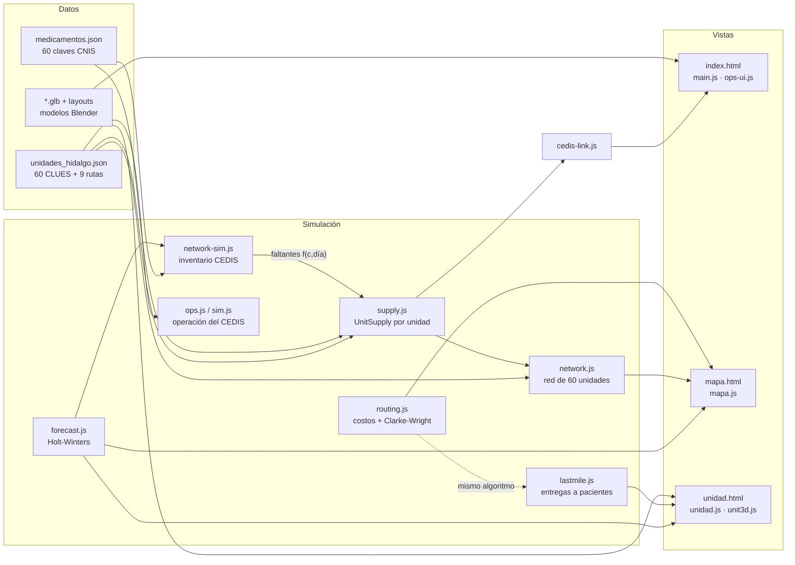

# Arquitectura

El visor es una aplicación estática: HTML, CSS y módulos ES de JavaScript, sin compilación ni servidor de
aplicación. Toda la operación se calcula en el navegador con una **simulación determinista**: la misma unidad, el
mismo día y la misma hora dan siempre el mismo resultado en cualquier equipo. Por eso el CEDIS (en la PC) y la
unidad (en el iPad) muestran la misma alerta sin hablar entre sí.

## Módulos

| Archivo | Responsabilidad |
|---|---|
| `js/supply.js` | Simulación de abasto por unidad (`UnitSupply`), calendario de rutas, lotes (`lotFor`), escenarios, prioridad (`reqScore`), alertas (`request`), pedido extraordinario (`proposeOrder`, `pexState`) |
| `js/network-sim.js` | Inventario del CEDIS por clave y lote, métodos de pedido (`minmax` / `forecast`), proveedor con retrasos y entregas parciales, asignación que iguala cobertura (`CedisInventory.allocate`) |
| `js/forecast.js` | `holtWinters`, `forecastSeries` (precisión WAPE por validación) y `suggestedOrder` |
| `js/routing.js` | Modelo de costos y volúmenes, rutas actuales contra optimizadas, semana e inserción de urgentes (`Router`) |
| `js/lastmile.js` | Pacientes simulados, vías de entrega, rutas de moto (`cwRoutes`), estados e indicadores (`LastMile`) |
| `js/network.js` | Corre las 60 unidades: semáforo, camionetas, diagnóstico de desabasto, redistribución y trazabilidad |
| `js/cedis-link.js` | Enlace unidades → CEDIS: alertas y pedidos extraordinarios en el panel del CEDIS (punto `>>> API`) |
| `js/ops.js`, `js/sim.js` | Operación interna del CEDIS (turno, andenes, equipos, cuarto frío) y calendario de rutas |
| `js/main.js`, `js/ui.js`, `js/ops-ui.js` | Vista CEDIS 3D: escena, capas (ocupación y cobertura por clave), inspector y paneles |
| `js/mapa.js` | Vista de la red estatal: mapa SVG de Hidalgo y pestañas |
| `js/unidad.js`, `js/unit3d.js` | Vista de la unidad: indicadores, tablas, gráficas y escena 3D (personas, moto, casillero, jefatura) |
| `js/scenario-ui.js` | Escenario, método de pedido y pedido automático compartidos entre vistas (URL + `localStorage`) |
| `js/contratos.js` | Motor de contratos (sin DOM): 8 contratos abiertos, órdenes de suministro multipartida a partir de los pedidos del inventario, dictamen de andén por partida, pena diaria sobre lo no entregado, bolsa de penas contra la fianza, entrega trunca, rescisión en días hábiles y rescate del segundo lugar. Pruebas: `node tests/contratos.test.mjs [normal|contingencia]` |
| `js/contratos-3d.js` | Patio de proveedores (`contratos_patio.glb`): camiones por remisión (patio → andén R2/R3 → salida, posición = f(t)), semáforos de andén, tablero de contratos, tarimas devueltas y pilas de expedientes por ventanilla |
| `js/contratos-ui.js` | Pestaña "Contratos": bolsa de penas por contrato, órdenes abiertas con sus partidas, camiones del día y bitácora con número de documento |
| `contratos.html`, `js/contratos-page.js` | Ventana de gestión: periodo (ayer, 7, 30, 90 días, vigencia o fechas) y contrato; 8 indicadores con comparación contra el periodo anterior, alertas al corte, gasto y pagos por día, penas y rechazos, avance contra mínimo y máximo con proyección, desempeño por proveedor, revisión de un día y exportación a CSV y JSON (`ExpedienteMaestro`). Abre con el corte del CEDIS (`?t=`) |
| `expedientes.html`, `js/expedientes.js` | Simulación del recorrido: cada OS es una ficha que viaja por 12 etapas (emisión, proveedor, patio, andén, almacén, factura, pago, cierre y los desvíos mora, devolución, incumplimiento y rescate del segundo lugar) según `etapaOS(os, t)`. Reproducción a 1 h/s – 3 días/s, línea de tiempo, filtro por contrato o incidencias, seguimiento de una OS con su línea de vida (documentos y plazos por etapa), movimientos en vivo y tiempo promedio por etapa |

## Modelo de simulación

**Tiempo.** El día 0 es el lunes 26 de octubre de 2026. Cada unidad simula 46 días anteriores: 16 de
calentamiento y 30 de historia visible. Después, el día en curso se procesa hasta el instante `t`. Los números
aleatorios salen de `mulberry32` con una semilla formada por el CLUES y el día.

**Demanda.**
- **Recetas:** Poisson por hora con pico a media mañana, según el tipo de unidad y el día de la semana.
- **Temporada respiratoria:** coseno anual, de 0 en julio a 1 en enero. Afecta a ambroxol, salbutamol,
  amoxicilina y otras claves.
- **Quirófano y urgencias:** kits por procedimiento.
- **Diferencia entre lo real y lo planeado:** la demanda real de cada clave difiere de la planeada, para que el
  pronóstico tenga valor.

**Inventario en la unidad.**
- Existencia por lote, con salida PEPS (primero caduca, primero sale) y merma por caducidad.
- Entrega ordinaria según la frecuencia de la ruta, con pedido a máximos.
- Si una clave llega a cero, se manda una **alerta** al CEDIS: N1 vital, N2 urgente o N3 prioritaria.
- Las solicitudes del mismo día se consolidan en una sola.
- Lo que no se surte queda como **receta pendiente**; se surte al llegar el medicamento y se cancela a los 10 días.

**Inventario del CEDIS** (`network-sim.js`).
- **Demanda de la red:** suma de las unidades. Revisión cada lunes.
  - *Mínimos y máximos:* 25 y 55 días de la demanda planeada.
  - *Pronóstico:* Holt-Winters sobre la demanda observada, más la semana de revisión y un colchón por retrasos.
- **Proveedor:** entrega de 10 a 21 días según la clave. Al 14 % de los pedidos les llega un retraso de 5 a 13
  días y al 10 % una entrega parcial.
- **Reparto:** si la existencia no alcanza hasta el siguiente arribo, el CEDIS reparte. El factor `f(c, día)` se
  instala en `supply.js` (`setCedisModel`) y de ahí salen los faltantes que ven las unidades.

**Pedido automático** (fase 3).
- **Cuándo:** cada mañana, con el consumo observado (promedio móvil exponencial), se calcula la existencia
  proyectada hasta la próxima entrega. Si queda bajo la existencia de seguridad, se genera un `PEX-…`.
- **Flujo:**
  1. propuesto;
  2. validado por la jefatura de farmacia (2 h);
  3. autorizado por el CEDIS (4 h);
  4. programado en ruta;
  5. entregado.
- **Envío:** en viaje propio si la clave se agota en menos de 1.5 días.

**Rutas** (`routing.js`).
- **Costo de cada ruta:** costo fijo + km × $/km + horas × $/hora.
- **Volumen:** según el tipo de pieza.
- **Restricciones:** capacidad de 8,000 L y jornada de 10 h.
- **Optimización:** ahorros de Clarke-Wright más 2-opt, con los mismos días de visita.
- **Distancias:** haversine × 1.35.

**Última milla** (`lastmile.js`).
- **Qué se entrega:** recetas pendientes ya surtidas y resurtibles de crónicos inscritos (~22 %).
- **Vías:** ventanilla, casillero 24 h, punto aliado o domicilio. Los controlados solo se entregan en ventanilla
  y la red fría no va a casillero.
- **Moto:** 2 salidas al día, con 18 paradas y 4 h como máximo por salida.
- **Comprobante:** QR.

**Contratos** (`contratos.js`).
- **Origen:** cada pedido semanal del inventario del CEDIS se vuelve una orden de suministro del contrato de su clave; un
  pedido retrasado se explica como retraso o como rechazo en el primer arribo (el reemplazo llega cuando el inventario
  recibe) y un pedido parcial es una entrega trunca. Así el inventario y los contratos nunca se contradicen.
- **Pena:** 2.5 % diario sobre el valor pendiente de cada partida, desde el día siguiente al vencimiento (acuse + plazo de
  la clave) hasta que se entrega o se notifica la imposibilidad. La bolsa del contrato se recalcula en cada instante.
- **Rescisión:** por imposibilidad de entrega (contingencia) o al alcanzar la garantía; 5 días hábiles para alegar
  (art. 77 LAASSP), resolución y orden de rescate al segundo lugar si su precio difiere ≤ 10 % (art. 54 fr. VI).
- **Pagos:** una factura por entrega aceptada; pago dentro de 17 días hábiles desde la verificación (art. 73) en la
  mayoría de los casos. La pena de la partida se cobra antes del pago que la cierra (art. 141 RLAASSP); si la partida se
  rescinde, la pena no se cobra y se hace efectiva la garantía.
- **Indicadores:** `kpis(d0, d1, contrato, corte)`, `serie()`, `avance()` y `dia()`. El cumplimiento es piezas a tiempo ÷
  piezas de las partidas que vencieron, como el Sistema de Monitoreo al Cumplimiento del Abasto (DOF 09-02-2026).
- **Fundamento:** LAASSP (DOF 16-04-2025) y su Reglamento (DOF 18-12-2025): arts. 54, 68, 73, 75 y 77. La tasa de pena,
  el plazo de entrega y la deducción por saldo son supuestos del modelo de contrato.

## Puntos de integración (`>>> API`)

| Punto | Archivo | Qué se conecta |
|---|---|---|
| Estado del turno, ocupación y temperatura del cuarto frío | `sim.js` | WMS / IoT del CEDIS |
| Solicitudes urgentes de las unidades | `cedis-link.js` | Sistema de farmacia de cada unidad (REST o WebSocket) |
| Existencias y arribos del CEDIS | `network-sim.js` | WMS del CEDIS y órdenes de compra |
| Pronóstico | `forecast.js` | Modelo de IA (misma interfaz `forecastSeries`) |
| Pedido extraordinario | `docs/pedido-extraordinario.schema.json` | Contrato tipo FHIR SupplyRequest |
| Contratos, órdenes y dictámenes de andén | `contratos.js` | Sistema de compras (contratos y OS) y WMS (recepción); `expediente()` ya entrega el formato `ExpedienteMaestro` |
| Domicilios y avisos a pacientes | `lastmile.js` | Expediente (con consentimiento) y SMS/WhatsApp |
| Distancias | `routing.js`, `lastmile.js` | Matriz de carretera (OSRM) |

## Rendimiento

- **Geometría estática:** el CEDIS (~6,800 mallas) se agrupa en `InstancedMesh` y lotes.
- **Carga de la red:** las 60 unidades se simulan en bloques para no trabar la página (unos 0.7 s).
- **Inventario del CEDIS:** 270 días × 60 claves, en unos 0.1 s.
- **iPad:** se limita la resolución y no se redibuja cuando la escena está en pausa.

---
© 2026 Gersain Barron · Licencia MIT
