# Modelos 3D (Blender)

Todos los modelos se construyen **con código** (Python `bpy` y `bmesh`) en Blender 5.2. Se pueden regenerar,
cambiar medidas y volver a exportar sin modelar a mano. Los objetos llevan propiedades personalizadas `wh_*`, que
se exportan a glTF como *extras* y que el visor usa para ligar el 3D con la simulación.

Forma de uso general, desde la consola de Python de Blender o desde una conexión MCP:

```python
g = {}
exec(open(r"<ruta>/script.py", encoding="utf-8").read(), g)
g["main"]()      # construye y guarda el .blend
g["export"]()    # en otra llamada: exporta el .glb y lo copia a web/assets
```

> La exportación glTF va en una llamada aparte de `main()`, porque después de `read_homefile` el contexto no tiene
> objeto activo. Las rutas `ROOT` de cada script apuntan a la carpeta del proyecto; ajústalas en tu equipo.

| Modelo | Script | Salida | Contenido |
|---|---|---|---|
| **CEDIS** | `warehouse_builder.py` (secciones en `src/wh_0*.py`) | `almacen_medicamentos.blend/.glb`, `warehouse_layout.json` | Nave de 50 × 30 m: 10 racks de tarima (500 posiciones), picking, cuarto frío de 2–8 °C, jaula de controlados, bandas, andenes, montacargas, reach truck, AGV y carritos. Incluye grafo de nodos, rutas, zonas y cámaras |
| **Claves por ubicación** | `cedis_claves.py` | Actualiza el `.blend` y el `.glb`; genera `web/assets/slot_claves.json` | Asigna una clave CNIS a cada una de las 1,506 ubicaciones (`wh_clave`, `wh_ven`, `wh_grupo`, `wh_zona_inv`): farmacia en tarimas, red fría en el cuarto frío, controlados en su jaula y todas las claves en picking. Pone un letrero por grupo terapéutico en cada rack |
| **Unidad médica** | `unidad/unidad_builder.py` | `unidad_medica.blend/.glb`, `unidad_layout.json` | Hospital tipo de 62 × 42 m: consulta, sala de espera (60 asientos), farmacia (3 ventanillas, ventanilla de vales y anaqueles), urgencias, CEyE, 4 quirófanos, almacén, andén y estacionamiento. **Fase 3:** módulo de jefatura de farmacia (terminal, tableta, tablero de pedidos). **Fase 4:** posición del casillero |
| **Vehículos** | `vehiculos/vehiculos_builder.py` | `vehiculos.blend/.glb` | Camioneta seca, camioneta refrigerada (red fría) y moto de reparto con caja |
| **Almacén regional** | `regional/almacen_regional_builder.py` | `almacen_regional.blend/.glb` | Nave de 36 × 22 m: 6 racks (144 posiciones), 4 estantes de picking, cuarto frío, controlados, consolidación por ruta, 3 andenes y oficina |
| **Casillero 24 h** | `recoleccion/punto_recoleccion_builder.py` | `punto_recoleccion.blend/.glb` | 24 compartimentos de 4 tamaños (`wh_type = locker_slot`), módulo central con pantalla, lector QR y teclado, techo con luz y letrero |
| **Patio de proveedores y contratos** | `contratos/contratos_builder.py` | `contratos_patio.blend/.glb` | Se superpone al CEDIS (mismas coordenadas). Patio de espera con 4 cajones (`yard_slot`), carril y nodos de circulación (`truck_node`), caseta de citas, semáforo por andén (`dock_light`, material propio), zona de rechazo (`reject_slot`), tablero de 8 lámparas (`contract_lamp`, `wh_index`), oficina con 4 ventanillas (`desk`, anclas `desk_stack`) y plantillas de tractocamión seco y refrigerado (`supplier_truck`, `wh_variant`) |
| **CENADI (nivel nacional)** | `nacional/cenadi_builder.py` | `cenadi.blend/.glb`; copia en `web/assets/cenadi.glb` | Centro Nacional de Distribución del ISSSTE (Birmex). Nave de 200 × 130 × 14 m: 52 filas de rack de 9 niveles (`rack_row` con `wh_bays`, `wh_levels`, `wh_pos_per_bay`, un objeto por fila), red fría 2–8 °C y congelación con 6 antecámaras, jaula de controlados, picking por pieza, cuarentena y validación ISSSTE, 24 carriles de consolidación (`lane`, `wh_region`). 38 andenes (`dock`, `wh_dock`): 14 de recepción al norte y 24 de embarque al sur. Patio, caseta, oficinas, comedor, planta de emergencia y tráileres (plantillas para `cenadi.html`). 33,732 posiciones contra 35,000 reportadas. `main()`, `preview()` y `export(copy_to_web)` |
| **Oficinas centrales ISSSTE** | `issste_buenavista/issste_buenavista_builder.py` | `issste_buenavista.blend/.glb` (no copiado a `web/assets`) | Antigua Torre de Ferrocarriles Nacionales (Jesús García 140, Buenavista, CDMX): 17 niveles y 61.5 m, planta en "Y" con tres alas y núcleo triangular ("libro abierto"). Raíz con `wh_type = oficinas_centrales`. Largo y ancho de las alas, ritmo de fachada y letrero son estimados |
| **Tipos de unidad (sin integrar)** | `unidades_tipo/unidades_medicas.py` | Solo script y vistas previas | CAF (pequeña, ámbar), UMF (mediana, verde) y hospital con torre, helipuerto y urgencias (azul), para distinguirlas en el mapa de red. Falta separarlos en builders con `main()/export()` y `wh_type` |

## Convenciones

- Unidades en metros; Blender usa Z arriba y three.js usa Y arriba. La conversión es `B(x, y, z) → (x, z, −y)`.
- **Materiales:** se buscan por `bl_idname` (`ShaderNodeBsdfPrincipled`) porque la interfaz de Blender está en
  español. Se fija `diffuse_color` para que las vistas previas en Workbench salgan con color.
- **Texto:** se convierte a malla y con `resolution_u = 2`, para que viaje en el GLB sin pesar.
- **Cuerpos grandes (CENADI):** las filas de rack son mallas compartidas (4 variantes de ocupación) y cada fila
  es un objeto; el visor calcula cada posición con `wh_bay_len` y `wh_level_h`. El techo y los domos llevan
  `wh_type = roof` para ocultarlos.
- **Hospital:** la geometría estática se une por zona y material para reducir llamadas de dibujo. El visor oculta
  zonas de segundo nivel en las UMF.

## Vistas previas

| | |
|---|---|
|  | 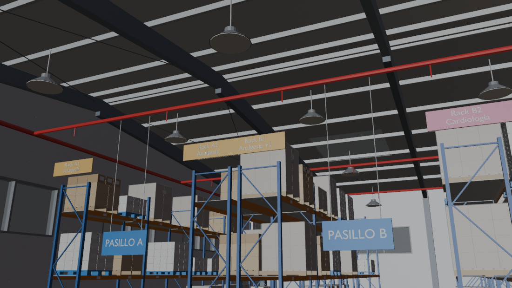 |
| 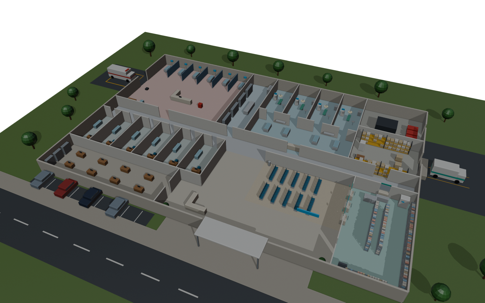 | 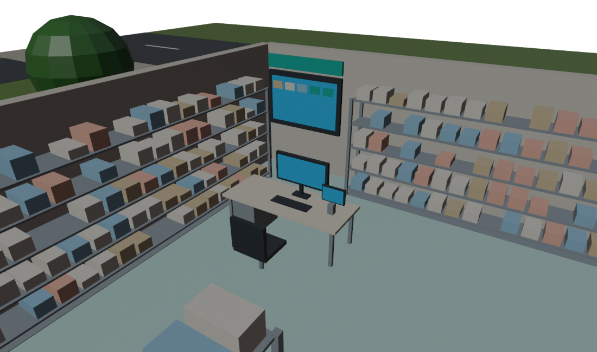 |
| 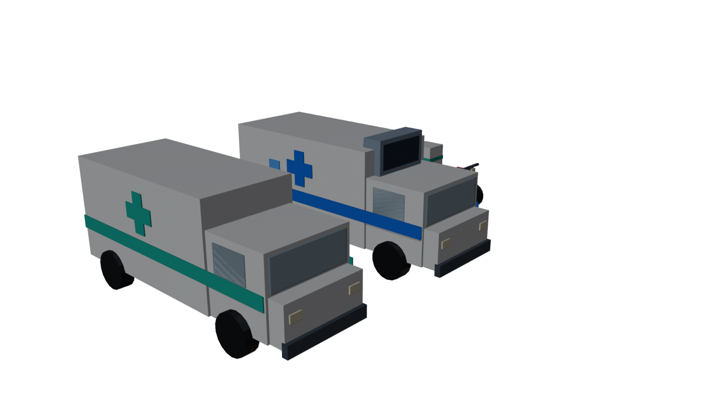 | 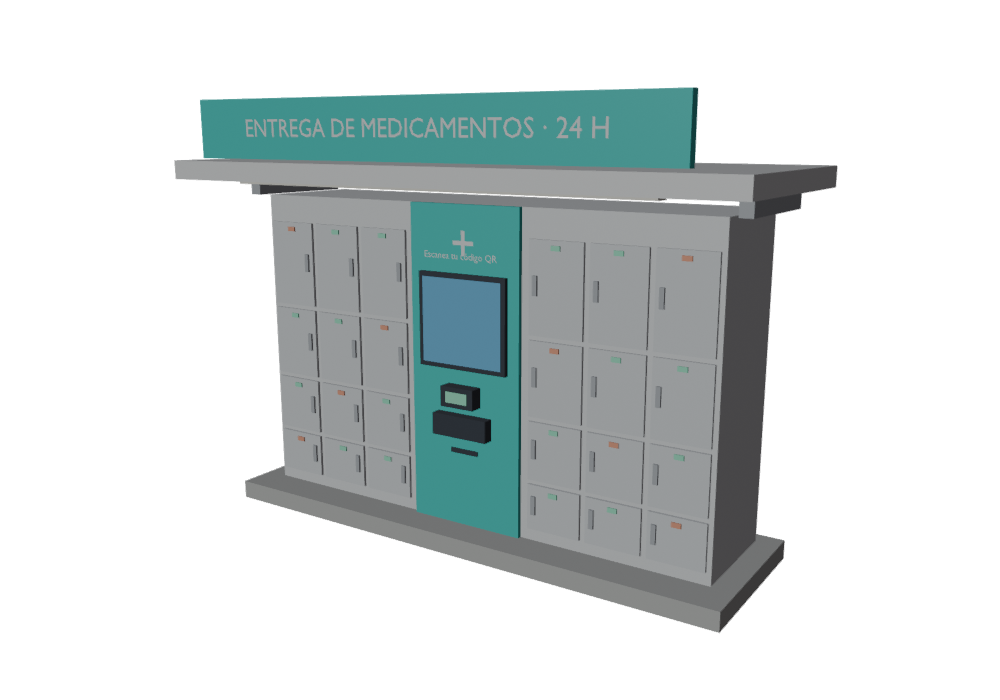 |
| 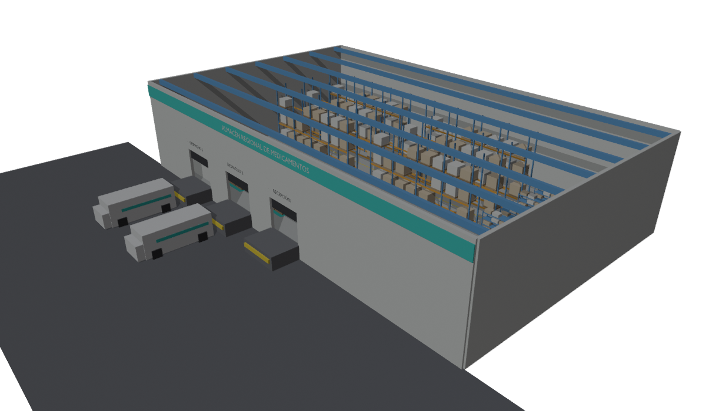 | 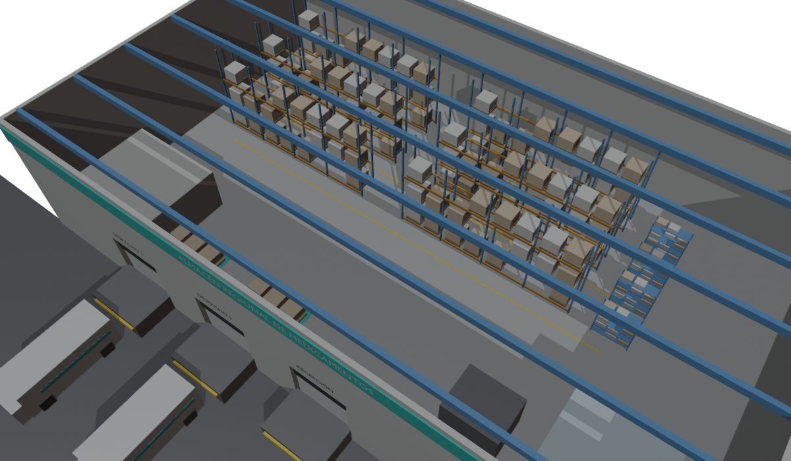 |
| 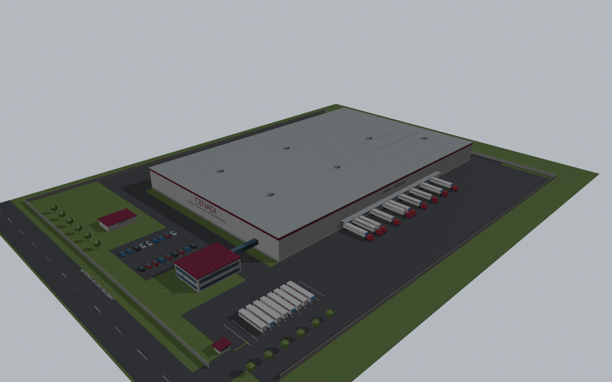 | 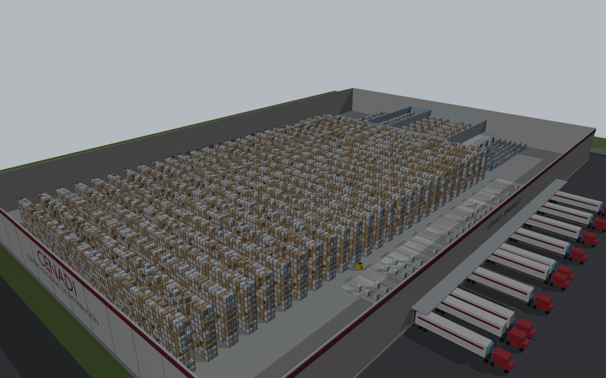 |
| 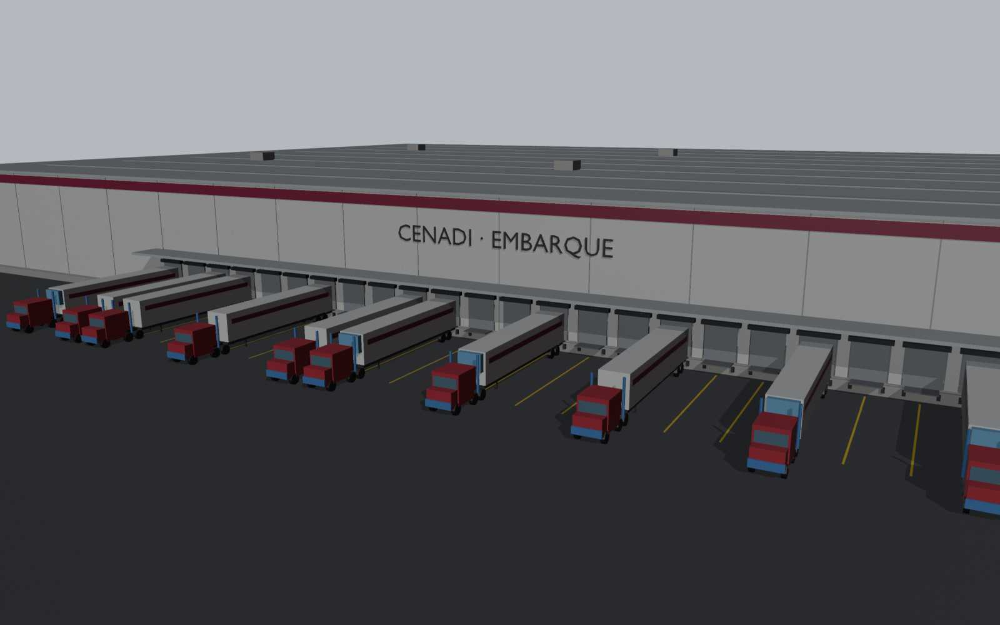 | 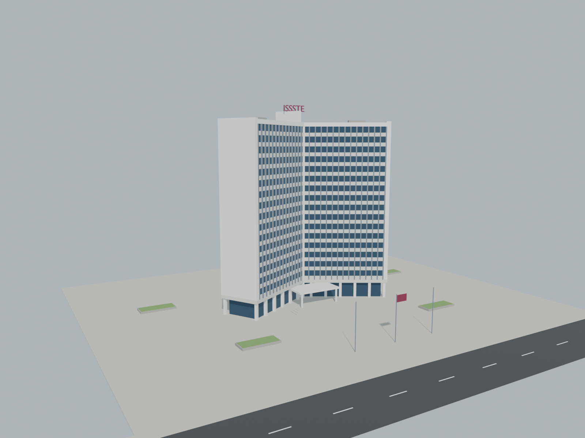 |
| 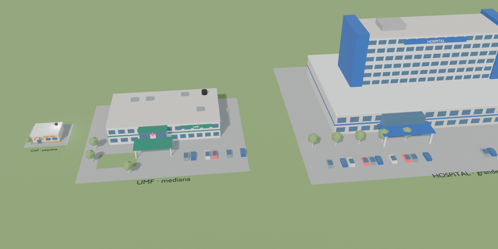 | 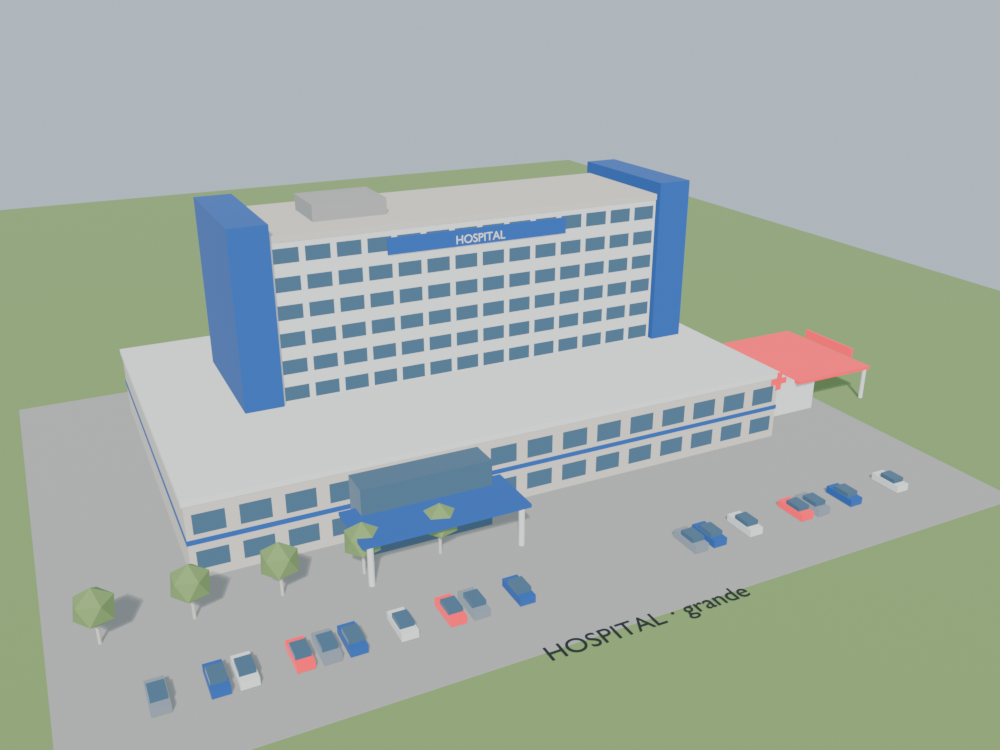 |

---
© 2026 Gersain Barron · Licencia MIT
